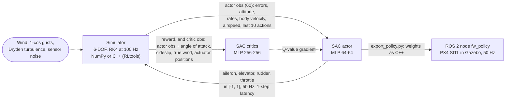

# Fixed-Wing: a fixed-wing UAV simulator and a low-level SAC flight controller

A NumPy and C++ (RLtools) fixed-wing simulator in the structure of L2F, in which SAC policies fly the four control
surfaces at 50 Hz. In wind and turbulence, SAC holds airspeed better than a cascaded PID on all 3 seeds (0.59 against
0.78 m/s RMS) but completes fewer of the 100 test flights on average (92 against 97).

[Python results](python/results/sac_gated_curriculum/README.md) · [C++ port and PX4 SITL](cpp/README.md) ·
[Reward and checks](docs/method.md) · Related: [WingJEPA](https://github.com/clementdumeril/WingJEPA),
[GeneticWing](https://github.com/clementdumeril/GeneticWing)


*Best windy SAC seed (seed 2) and the PID on test scenario 1, same wind and turbulence. Made with `python/examples/make_videos.py`.*

## Overview

MEng capstone at UC Berkeley, ARPL (Prof. Giuseppe Loianno), started October 2026 and in progress. The question
behind it: for sim-to-real transfer of a low-level fixed-wing policy, how much does a faithful model help compared
with wide domain randomization? This repository is the simulator and training side. The airframe is a placeholder:
the Aerosonde of Beard and McLain in Python, and PX4's Gazebo `advanced_plane` as an option in C++. There is no model
of the lab's Strix yet and no real flight.

The structure (parameters, state, RK4, observe / reward / terminate) follows L2F from RLtools; the fixed-wing physics,
wind models, task, PID baseline, C++ port and PX4 deployment are mine. Training uses SAC from stable-baselines3
(Python) and from RLtools (C++).



*Asymmetric actor-critic: the actor sees only what PX4 estimates, the critic also sees privileged air data. The same
task is implemented in `python/fixed_wing/airplane/environment.py` and `cpp/include/fixed_wing/dynamics.h`.*

## Results

Task: from a perturbed start, hold an airspeed (20 to 30 m/s), an altitude (±20 m) and a course (±90°) for 30 s.
Every pilot flies the same 100 test scenarios (seeds 0 to 99; training uses other seeds). Windy: constant wind up to
5 m/s, light Dryden turbulence, sensor noise. SAC rows: mean ± standard deviation over 3 seeds, 1 M steps each.
RMS errors over the second half of the complete flights.

| Pilot | Air | Complete flights / 100 | Mean return (max 1500) | Airspeed RMS (m/s) | Altitude RMS (m) | Course RMS (deg) |
| --- | --- | --- | --- | --- | --- | --- |
| PID | calm | 100 | 1322 | 0.37 | 0.68 | 0.0 |
| SAC, Python (3 seeds) | calm | 90 ± 3 | 1163 ± 21 | 0.55 ± 0.22 | 2.33 ± 0.15 | 4.4 ± 2.1 |
| SAC, C++ critic 256 (3 seeds) | calm | 97 ± 1 | 1335 ± 19 | 0.23 ± 0.06 | 0.99 ± 0.89 | 1.7 ± 1.0 |
| SAC, C++ critic 64 (3 seeds) | calm | 69 ± 49 | 642 ± 184 | 2.30 ± 1.02 | 15.54 ± 12.70 | 37.3 ± 19.8 |
| PID | windy | 97 | 1238 | 0.78 | 1.34 | 0.1 |
| SAC, Python (3 seeds) | windy | 92 ± 7 | 1197 ± 70 | 0.59 ± 0.05 | 1.73 ± 0.45 | 3.6 ± 0.9 |

Printed by `python examples/results_table.py` from the committed `evaluation.json` files of
[`python/results/sac_gated_curriculum`](python/results/sac_gated_curriculum/README.md) and
[`cpp/results/sweep`](cpp/results/sweep/README.md).

- On average the PID is still the better pilot. The best windy seed completes 99 flights against 97 for the PID.
- In wind, SAC holds airspeed better than the PID on every seed; its commands change 15 to 23 times more per step.
- Of the 53 early terminations over the 6 Python policies, 41 happen in the first 5 s and 49 on the angle of attack:
  from a perturbed start and a large course change the policy banks 50 to 80° and pulls, where the PID limits its
  bank to 30° (`*/diagnosis.json`).
- In C++ the critic size decides. With 256 units the policy learns in 115 to 158 min per seed on one core; with the
  L2F size (64) it never learns the course. The C++ port is checked and trained in calm air only.
- I have not isolated why the C++ runs learn better than the Python runs with the same settings.

## What I built

| Component | Path | What it is | Origin |
| --- | --- | --- | --- |
| Simulator | `python/fixed_wing/airplane/` | 6-DOF rigid body, linear aerodynamics (28 coefficients), actuator lag, command latency, RK4 substeps, Newton trim | L2F skeleton, fixed-wing physics mine |
| Wind | `airplane/operations.py` | constant wind, 1-cos gust, Allen thermals, Dryden turbulence with exact discretization | models from Beard and McLain, Allen (2006) |
| RL task | `airplane/environment.py` | Gymnasium task, reward, gated curriculum with replay-buffer recomputation, one `evaluate` for every pilot | curriculum idea from L2F |
| Baseline | `airplane/pid.py` | cascaded PID on the same measurements as the actor, bank limited to 30° | mine |
| Training | `examples/train_sac.py`, `airplane/asymmetric_sac.py` | SAC with an asymmetric actor-critic | stable-baselines3 |
| C++ port | `cpp/include/fixed_wing/`, `cpp/src/train_sac.cpp` | same airplane and task in the RLtools MDP form; PX4 `advanced_plane`; tracking task (C++ only) | RLtools SAC |
| PX4 deployment | `cpp/deploy/ros2/fw_policy/`, `cpp/tools/export_policy.py`, `cpp/src/compare_sitl.cpp` | ROS 2 node that flies an exported actor on PX4 SITL over uXRCE-DDS, and a replay of SITL logs in this simulator | mine |
| Diagnostics | `examples/diagnose_flights.py`, `examples/reward_saturation.py` | attitude in straight flight, cause of every failure, reward flatness under exploration noise | mine |
| Tests | `python/tests/` | 51 tests: trim, control signs, wind, Allen and Dryden statistics, Gymnasium checker, reward recomputation | mine |

Checks that the numbers rest on: the C++ port replays 11 Python flights (7136 steps) with states within 7e-13
([`cpp/results/compare_with_python.txt`](cpp/results/compare_with_python.txt)); the Aerosonde glides at 15.7
against 7.9 for the published Strix numbers, so it has about half the Strix drag
([`python/PARAMETERS.md`](python/PARAMETERS.md)). Reward, terminations and the three reward fixes are in
[`docs/method.md`](docs/method.md).

## Installation

Tested with Python 3.11 on Windows 10 and on Savio (Linux, `python/3.11.6-gcc-11.4.0`). Dependencies are not pinned.

```bash
cd python
python -m venv ~/.venvs/fixed-wing && source ~/.venvs/fixed-wing/bin/activate
pip install -e ".[dev,rl]"
pytest                                   # 51 passed, about 1 min
```

The C++ build (CMake, fetches a fixed RLtools commit, Intel MKL or OpenBLAS) is in [`cpp/README.md`](cpp/README.md);
the ROS 2 node runs on Ubuntu 24.04 with ROS 2 Jazzy and PX4 SITL.

## Usage

```bash
python examples/pid_baseline.py          # PID on the 100 test scenarios, about 6 min
                                         # -> "success_rate": 1.0, "mean_return": 1321.8...
python examples/train_sac.py --steps 1000000 --n-envs 8 --out runs/sac        # about 4 h on 8 cores
python examples/train_sac.py --steps 1000000 --n-envs 8 --wind-max 5 --turbulence light --noise 1 --out runs/sac_windy
```

Each run writes `runs/<name>/` with `config.json`, `progress.csv`, `model.zip` and `evaluation.json` (same fields
and test scenarios as the PID). Savio job files: [`python/savio/README.md`](python/savio/README.md),
[`cpp/README.md`](cpp/README.md#on-savio).

## Reproducing figures

From `python/`, on a committed run directory:

| Output | Command |
| --- | --- |
| README table | `python examples/results_table.py` |
| `training_calm.png`, `training_windy.png` | `python examples/plot_training.py results/sac_gated_curriculum/calm_seed* --out training_calm.png` |
| `flights_windy_seed2.png` | `python examples/compare_flights.py --model results/sac_gated_curriculum/windy_seed2/model.zip --wind-max 5 --turbulence light --noise 1 --out flights.png` |
| `rl_vs_pid_windy_scenario1.gif` | `python examples/make_videos.py results/sac_gated_curriculum/windy_seed2 --seed 1 --comparison-only` |
| `diagnosis.json` | `python examples/diagnose_flights.py results/sac_gated_curriculum/windy_seed2 --out diagnosis.json` |
| `cpp/results/sweep/sweep.png` | `python tools/plot_sweep.py results/sweep` (from `cpp/`) |

`model.zip` is committed for `calm_seed0` and `windy_seed2` only.

## Limitations

- Placeholder airframes (Aerosonde, PX4 `advanced_plane`), linear aerodynamics without stall: the angle-of-attack
  limit ends the episode instead.
- Nominal airplane, no parameter randomization yet, so the results do not yet answer the research question.
- Three seeds per condition. Success varies by up to 14 flights between seeds and by about 10 between neighboring
  checkpoints of one seed, so small differences between variants are not significant.
- Wind, turbulence and sensor noise are not ported to C++.
- The tracking task and the PX4 SITL flights are described in [`cpp/README.md`](cpp/README.md), but their
  evaluation files and flight logs are not committed, so no number from them is reported here.
- No flight test.

## Credits

- L2F and RLtools: J. Eschmann, D. Albani, G. Loianno, "Learning to Fly in Seconds", RA-L 2024
  ([arXiv:2311.13081](https://arxiv.org/abs/2311.13081)); [rl-tools/rl-tools](https://github.com/rl-tools/rl-tools)
  and its [ui-server](https://pypi.org/project/ui-server/) viewer.
- Aerosonde and Dryden parameters: R. Beard and T. McLain, *Small Unmanned Aircraft*, 2012.
- Thermal model: M. J. Allen, "Updraft Model for Development of Autonomous Soaring Uninhabited Air Vehicles",
  AIAA 2006-1510.
- `advanced_plane` model: PX4 Gazebo models. SAC: [stable-baselines3](https://github.com/DLR-RM/stable-baselines3).
- MEng capstone at ARPL, UC Berkeley, advised by Prof. Giuseppe Loianno.

Clément Dumeril, [clement.dumeril.net](https://clement.dumeril.net). MIT license, see [LICENSE](LICENSE); citation
metadata in [CITATION.cff](CITATION.cff).
