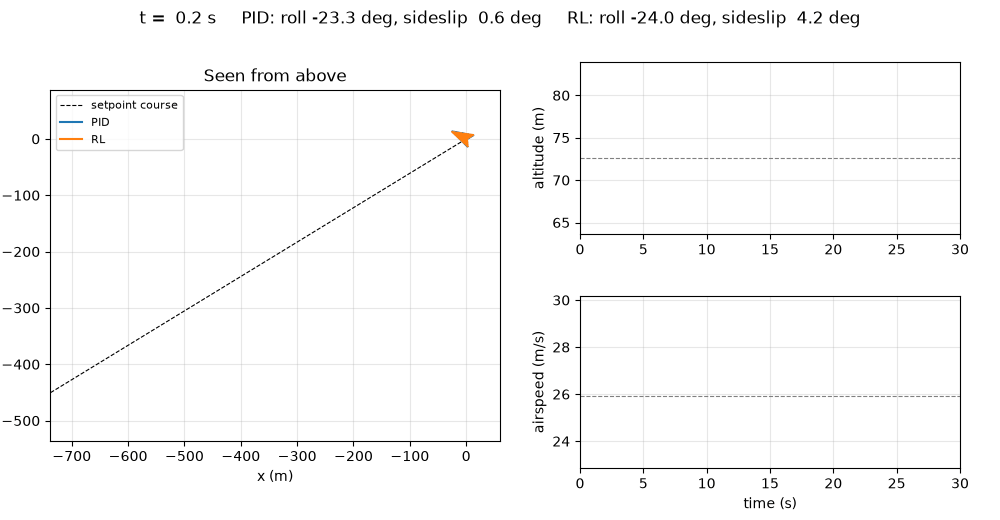

# Fixed-wing simulator and low-level RL controller

A NumPy fixed-wing simulator built on the structure of L2F (RLtools), with a Gymnasium task in which a SAC policy flies
the control surfaces directly. First result: 98 of 100 test flights and a return on par with a PID, but flown in a
sideslip that I traced back to the reward.



I started this in October 2026 for my MEng capstone at UC Berkeley, at ARPL (Prof. Giuseppe Loianno), on
reinforcement learning for the lab's Strix fixed-wing UAV. The research question: for sim-to-real transfer of a
low-level policy, how much does a faithful model help compared with wide domain randomization? This repository is the
simulator and training side. The airplane is still a placeholder (Aerosonde) until the Strix model is available.

## Results

First SAC run: 1 M steps, 2 h 42 on 8 cores of Savio, calm air, nominal airplane, one seed. Both pilots fly the same
100 test scenarios (seeds 0 to 99; training uses other seeds). Source: [`results/sac_run1`](python/results/sac_run1/README.md).

| 100 test scenarios | PID baseline | SAC |
| --- | --- | --- |
| Complete flights | 100 | 98 |
| Mean return (max 1500) | 1340 | 1358 |
| Airspeed RMS error | 0.37 m/s | 0.14 m/s |
| Altitude RMS error | 0.68 m | 0.87 m |
| Course RMS error | 0.0° | 8.2° |

SAC reaches the setpoint faster and with less overshoot. It then settles 25° banked with crossed aileron and rudder,
in a 9° sideslip, which explains the course error and the extra throttle. The reward penalized neither sideslip nor the
commands themselves, so the policy found this equilibrium.

The next run added an L2F-style curriculum and failed: once the weight on command changes reached 50, SAC's
exploration noise alone kept the cost at its cap, the reward went flat and the policy stopped tracking the setpoint.
The reward now has a sideslip term, a distance-to-trim term, a smooth (tanh) cap and a command-change weight of 1.

## What I built

- **Simulator** (`python/fixed_wing/airplane/`): the L2F skeleton (`Parameters` / `State` / dynamics, RK4,
  post-integration) ported to NumPy with fixed-wing physics: 6-DOF rigid body, linear aerodynamics (28 coefficients),
  first-order actuator lag, command latency, RK4 substeps and a Newton trim solver.
- **Wind**: constant wind, "1 − cos" gust, Allen's thermal model (NASA, AIAA 2006-1510) and Dryden turbulence
  discretized exactly, so its statistics do not depend on the control rate.
- **RL task** (`environment.py`, Gymnasium): hold an airspeed, an altitude and a course from a perturbed start, with
  the L2F ingredients. The actor sees only what PX4 estimates plus its last 10 actions; the critic also sees angle of
  attack, sideslip, the true wind and the randomization factors. Survival-bonus reward with a curriculum that
  recomputes the replay buffer. Wind, turbulence, sensor noise and parameter randomization are options.
- **Baseline and evaluation**: a cascaded PID (`pid.py`) using the same measurements as the actor, and one
  `evaluate` function for every pilot on the same scenarios.
- **Training and visualization**: SAC with stable-baselines3 and an asymmetric policy (`asymmetric_sac.py`), Savio job
  files, learning curves, GIFs, and a live 3D viewer that flies one airplane or 36 at once.

Inherited: the L2F structure and its quaternion and RK4 helpers (translated to Python), the ui-server protocol, and the
Aerosonde coefficients from Beard and McLain.

## How it works

The policy outputs aileron, elevator, rudder and throttle commands in [−1, 1] at 50 Hz. Each step earns
`r = 1 − 0.5 tanh(cost / 0.5)`, where the cost sums squared, scaled errors on airspeed, altitude, course and sideslip,
command changes, and the distance of the commands to the trim at the setpoint airspeed. A step in flight always earns
at least 0.5, so ending the episode never pays. Episodes end below 20 m, outside 15 to 40 m/s, 50 m from the altitude
setpoint, or with angle of attack outside [−10°, 15°], since the linear model has no stall.

## How I checked it

- 48 tests (`pytest`): trim equilibrium, control signs, a constant wind that only shifts the trajectory, the Allen
  check case (outer radius 79.4 m, 5 updrafts per km²), Dryden variance and correlations, latency, substeps, the
  Gymnasium environment checker, and reward recomputation matching the environment reward.
- Flight performance against published Strix numbers ([`PARAMETERS.md`](python/PARAMETERS.md)): the placeholder
  glides at 15.7 against 7.9, so it has about half the Strix drag.
- The PID shows the task is feasible before any training.
- Since the curriculum run, I check before each run how often the reward is nearly flat under exploration noise
  (`examples/reward_saturation.py`).

## Limitations

- Aerosonde placeholder, not the Strix, and linear aerodynamics without stall.
- The results above are one seed, in calm air, with a nominal airplane: they do not yet address the research question.
- The Python simulator runs about 350 steps/s per core, so 1 M steps take about 3 hours. A C++ port to RLtools is
  planned once the task is settled.
- No flight test yet.

## Status

- [x] Simulator, wind models, comparison with published Strix numbers
- [x] RL environment, PID baseline, first SAC policy
- [ ] Reward fix, 3 seeds in calm air (running on Savio)
- [ ] Wind up to 5 m/s, Dryden turbulence and sensor noise, 3 seeds (running on Savio)
- [ ] Domain randomization, MLP against GRU policies
- [ ] Strix model, then trajectory tracking to compare with the lab's NMPC

## Reproduce

```bash
cd python
python -m venv ~/.venvs/fixed-wing && source ~/.venvs/fixed-wing/bin/activate
pip install -e ".[dev,rl]"
pytest                                   # about 1 min
python examples/pid_baseline.py          # PID on the 100 test scenarios, about 6 min
python examples/train_sac.py --steps 1000000 --n-envs 8 --out runs/sac   # about 3 h on 8 cores
```

On Savio: [`python/savio/README.md`](python/savio/README.md). Figures and GIFs: `examples/plot_training.py`,
`compare_flights.py`, `make_videos.py`, `make_3d_videos.py`. Setup details and the viewer:
[`python/README.md`](python/README.md). Changes from L2F: [`python/DIFFERENCES_L2F.md`](python/DIFFERENCES_L2F.md).

## Credits

- L2F simulator and RLtools: J. Eschmann, D. Albani, G. Loianno, "Learning to Fly in Seconds", RA-L 2024
  ([arXiv:2311.13081](https://arxiv.org/abs/2311.13081)), [rl-tools/rl-tools](https://github.com/rl-tools/rl-tools),
  and the [ui-server](https://github.com/rl-tools/ui-server) viewer.
- Aerosonde parameters, Dryden gust parameters: R. Beard and T. McLain, *Small Unmanned Aircraft*.
- Thermal model: M. J. Allen, "Updraft Model for Development of Autonomous Soaring Uninhabited Air Vehicles", AIAA
  2006-1510.
- SAC implementation: [stable-baselines3](https://github.com/DLR-RM/stable-baselines3).
- MEng capstone at ARPL, UC Berkeley, advised by Prof. Giuseppe Loianno.

Clément Dumeril, [clement.dumeril.net](https://clement.dumeril.net). MIT license.
