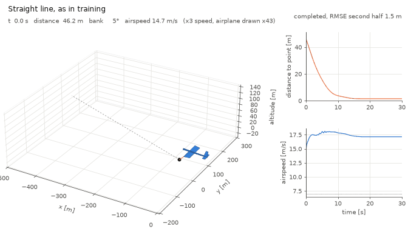
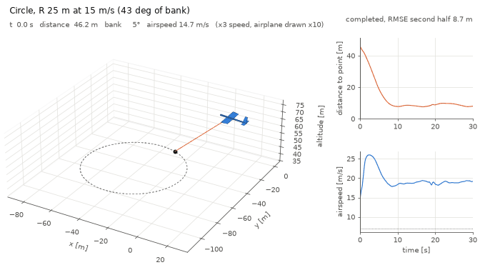
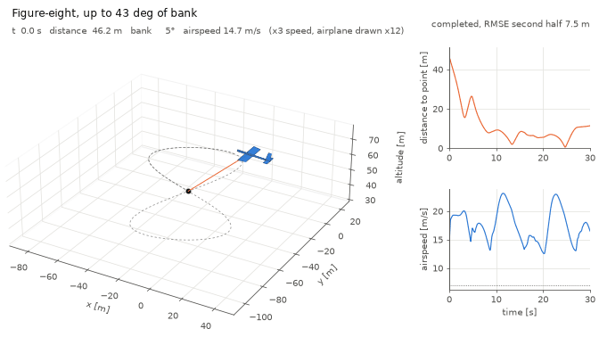
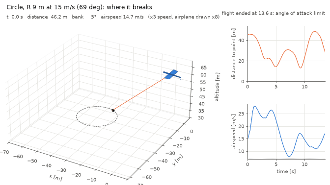
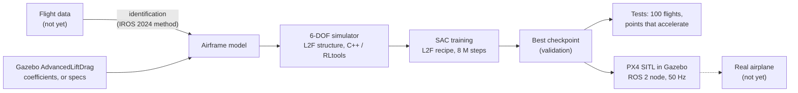
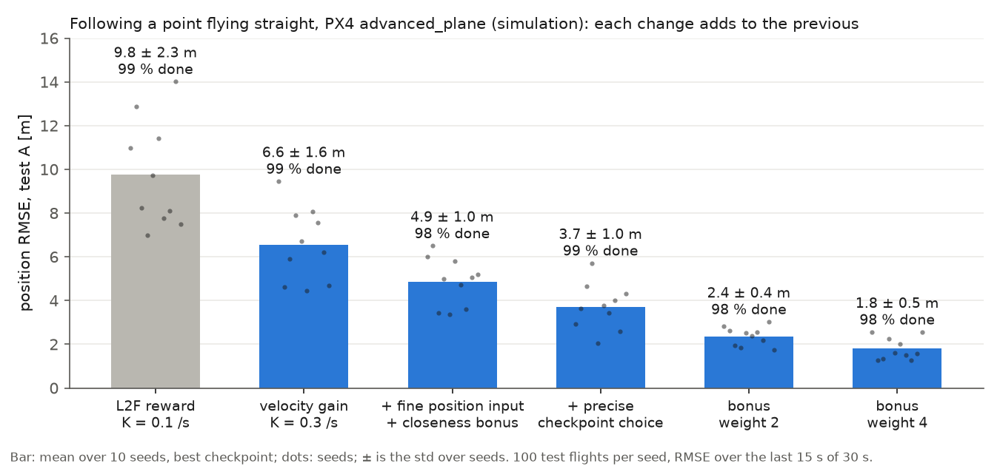
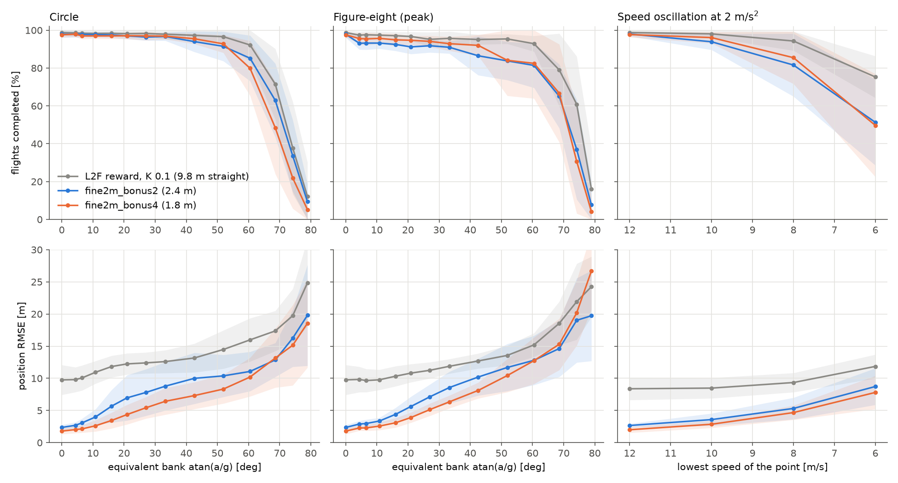

# Fixed-Wing: reinforcement learning for low-level fixed-wing flight control

| Straight line, as in training | Circle, R 25 m (43° of bank) |
| --- | --- |
|  |  |
| **Figure-eight, up to 43° of bank** | **Circle, R 9 m (69°): where it breaks** |
|  |  |

*A SAC policy flying PX4's `advanced_plane` (blue, drawn 10 times larger than its span) after a moving point (black),
in simulation, 3 times real speed. Right of each: distance to the point and airspeed. Trained only on points that fly
straight; first test flight of seed 4 of `fine2m_bonus4` at each level
([`reference_suite_fine`](cpp/results/reference_suite_fine/README.md)).*

A fixed-wing flight simulator I wrote in Python and C++ (RLtools), in which SAC policies fly the four control surfaces
at 50 Hz. MEng capstone at UC Berkeley, ARPL (Prof. Giuseppe Loianno). Simulation only.

- Following a moving point flying straight on PX4's `advanced_plane`: 1.4 m position error (RMS) and 98% of test
  flights completed, over 10 training seeds, down from 9.8 m with the L2F reward.
- Points that turn: 2.0 m on a 300 m circle, 4.4 m at 21° of bank, 7.3 m at 43°; past 60° of bank the policy fails.
- The lab's 83 g E-flite UMX Eratix, modeled from its specs: SAC flies it after 2.4 min of training and completes 99%
  of test flights after the full 18 min run.
- The trained policy flies the airplane in PX4 SITL and Gazebo through a ROS 2 offboard node at 50 Hz. An
  identification flight showed no bias between this simulator's predictions and Gazebo.

[Poster](poster/README.md) · [Detailed results](docs/RESULTS.md) · [Reward and method](docs/method.md) · [C++ port and PX4 SITL](cpp/README.md) ·
[Eratix model](docs/eratix_model.md) · [Components](docs/reproduce.md) ·
Related: [WingJEPA](https://github.com/clementdumeril/WingJEPA), [GeneticWing](https://github.com/clementdumeril/GeneticWing)

## Pipeline



1. **Model.** The `advanced_plane` uses the coefficients Gazebo simulates it with (AdvancedLiftDrag); the Eratix comes
   from its specs. Identifying a real airplane from its flights, as L2F's authors do for quadrotors (Eschmann, Albani,
   Loianno, IROS 2024), is the next step and is not done here.
2. **Simulator.** 6-DOF rigid body, actuator lag and latency, RK4 at 50 Hz, in the structure of L2F (parameters, state,
   observe / reward / terminate), so that RLtools trains on it as on its quadrotor.
3. **Training.** SAC with L2F's update intervals and batch, asymmetric actor-critic, random starts (roll ±60°), 8 M
   steps: 32 min on one core, 95 % of it in the network updates. Reward: L2F's form (2 minus squared costs, gated curriculum of the weights), with a
   velocity target toward the point, a fine-scale position input and a bonus for staying close
   ([method](docs/method.md)).
4. **Selection.** Every 50 k steps a validation flight set; the kept actor is the most precise one with at least 97 %
   of flights completed.
5. **Tests.** 100 flights from level and from random starts on a straight line, then circles, helices, figure-eights
   and speed changes with the acceleration swept past what the airplane can follow.
6. **Deployment.** The actor is exported as C++ and flown in PX4 SITL; the real airplane is not flown yet.

## Results



From the L2F reward (9.8 m) to 1.4 m, each change kept: a stronger velocity target toward the point (K 0.1 to 0.3 /s),
the position error also seen on a 2 m scale with a bonus for being close, the precise checkpoint choice, a larger
bonus weight and twice the steps. What is left is a steady offset of about 1 m per axis (behind, sideways, altitude)
with 0.1 m of motion around it ([`fine_px4plane`](cpp/results/fine_px4plane/README.md)). L2F's smaller critics (32 or
64 instead of 128) train 1.7–2.7 times faster but lose the precision
([`speed_px4plane`](cpp/results/speed_px4plane/README.md)). Script: `cpp/tools/plot_error_reduction.py`.



When the point turns or changes speed, the error grows as a lag behind it (5.6 m behind at 43° of bank): the policy
sees the point's position and velocity, not its acceleration, and never trained on a turning point. The more precise
policies also fail earlier past 60° of bank (48 % of circles completed at 69°, against 72 % for the L2F reward).
Training on accelerating points, with the point's acceleration in the observation, is the next step.

## How it works

- 6-DOF simulator (linear aerodynamics, or Gazebo's AdvancedLiftDrag with its post-stall blend for the
  `advanced_plane`; actuator lag, latency, RK4) in the structure of L2F, "Learning to Fly in Seconds". The C++ port
  matches the Python one to 7e-13 over 7,136 steps.
- Three airframes: the Aerosonde, PX4's `advanced_plane` as Gazebo simulates it, and the E-flite UMX Eratix.
- SAC with an asymmetric actor-critic: the actor sees only what PX4 estimates; the critics also see angle of attack,
  sideslip and the true wind.
- Tracking task: the policy sees its position error to the point (also on a fine 2 m scale) and its velocity error;
  the reward pushes its velocity toward the point (gain 0.3 /s) and adds a bonus for staying close.
- Videos: `cpp/tools/render_flight_video.py` turns recorded flights into a 3D animation (GIF or MP4).
- Deployment: the actor is exported as plain C++ and run in a ROS 2 node that sends actuator commands to PX4 over
  uXRCE-DDS.

## Run it

Python simulator and tests (Python 3.11, Windows 10 or Linux):

```bash
cd python
pip install -e ".[dev,rl]"
pytest                                   # 51 passed, about 1 min
python examples/train_sac.py --steps 1000000 --n-envs 8 --out runs/sac
```

C++ training and PX4 SITL (Ubuntu 24.04, ROS 2 Jazzy, PX4 built with `make px4_sitl`), from `cpp/`:

```bash
cmake -S . -B build -DCMAKE_BUILD_TYPE=Release && cmake --build build --config Release
python tools/export_policy.py <run>/actor.h deploy/ros2/fw_policy/policy/policy_weights.h
bash deploy/ros2/setup_wsl.sh ~/PX4-Autopilot <RLtools include directory>
bash deploy/ros2/fly_sitl.sh
```

All targets and options: [cpp/README.md](cpp/README.md). Figure scripts: [docs/reproduce.md](docs/reproduce.md).

## Limitations

- Simulation only, no real flight. The Eratix model comes from specs and textbook aerodynamics, not flight data yet.
- The tracking policies are trained and tested in calm air; wind and turbulence exist only in the Python task.
- No domain randomization in the reported runs, so the sim-to-real question behind the project is still open.
- On the first task (hold airspeed, altitude, course in wind) a tuned PID still completes more flights than SAC.

## Credits

L2F and RLtools: J. Eschmann, D. Albani, G. Loianno, "Learning to Fly in Seconds", RA-L 2024
([arXiv:2311.13081](https://arxiv.org/abs/2311.13081)), [rl-tools/rl-tools](https://github.com/rl-tools/rl-tools).
Aerosonde and Dryden parameters: Beard and McLain, *Small Unmanned Aircraft*, 2012. Thermals: M. J. Allen,
AIAA 2006-1510. `advanced_plane`: PX4 Gazebo models. SAC: [stable-baselines3](https://github.com/DLR-RM/stable-baselines3).

Clément Dumeril, [clement.dumeril.net](https://clement.dumeril.net). MIT license ([LICENSE](LICENSE)); citation in
[CITATION.cff](CITATION.cff).
