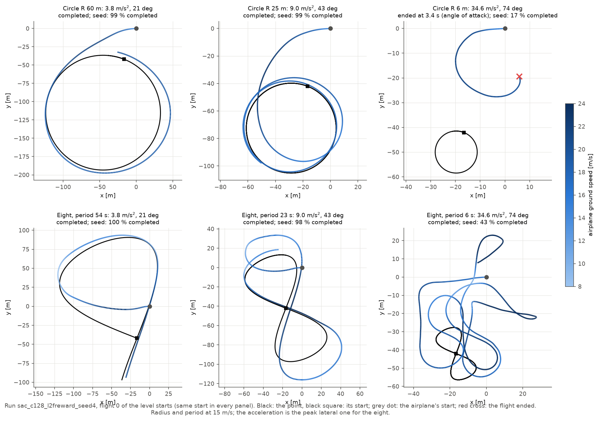

# Fixed-Wing: reinforcement learning for low-level fixed-wing flight control



*A SAC policy on PX4's `advanced_plane` (blue) following a moving point (black). It was trained on points that fly
straight; the tightest circle and figure-eight (right) are beyond what it can fly. Simulation.*

A fixed-wing flight simulator I wrote in Python and C++ (RLtools), in which SAC policies fly the four control surfaces
at 50 Hz. MEng capstone at UC Berkeley, ARPL (Prof. Giuseppe Loianno). Simulation only.

- Following a moving point flying straight on PX4's `advanced_plane`: 1.8 m position error (RMS) and 98% of test
  flights completed, over 10 training seeds.
- The lab's 83 g E-flite UMX Eratix, modeled from its specs: SAC flies it after 2.4 min of training and completes 99%
  of test flights after the full 18 min run.
- The trained policy flies the airplane in PX4 SITL and Gazebo through a ROS 2 offboard node at 50 Hz. An
  identification flight showed no bias between this simulator's predictions and Gazebo.

[Detailed results](docs/RESULTS.md) · [Reward and method](docs/method.md) · [C++ port and PX4 SITL](cpp/README.md) ·
[Eratix model](docs/eratix_model.md) · [Components](docs/reproduce.md) ·
Related: [WingJEPA](https://github.com/clementdumeril/WingJEPA), [GeneticWing](https://github.com/clementdumeril/GeneticWing)

## How it works

- 6-DOF simulator (linear aerodynamics, or Gazebo's AdvancedLiftDrag with its post-stall blend for the
  `advanced_plane`; actuator lag, latency, RK4) in the structure of L2F, "Learning to Fly in Seconds". The C++ port
  matches the Python one to 7e-13 over 7,136 steps.
- Three airframes: the Aerosonde, PX4's `advanced_plane` as Gazebo simulates it, and the E-flite UMX Eratix.
- SAC with an asymmetric actor-critic: the actor sees only what PX4 estimates; the critics also see angle of attack,
  sideslip and the true wind.
- Tracking task: the policy sees its position error to the point (also on a fine 2 m scale) and its velocity error;
  the reward pushes its velocity toward the point (gain 0.3 /s) and adds a bonus for staying close.
- Deployment: the actor is exported as plain C++ and run in a ROS 2 node that sends actuator commands to PX4 over
  uXRCE-DDS.

## Run it

Python simulator and tests (Python 3.11, Windows 10 or Linux):

```bash
cd python
pip install -e ".[dev,rl]"
pytest                                   # 51 passed, about 1 min
python examples/train_sac.py --steps 1000000 --n-envs 8 --out runs/sac
```

C++ training and PX4 SITL (Ubuntu 24.04, ROS 2 Jazzy, PX4 built with `make px4_sitl`), from `cpp/`:

```bash
cmake -S . -B build -DCMAKE_BUILD_TYPE=Release && cmake --build build --config Release
python tools/export_policy.py <run>/actor.h deploy/ros2/fw_policy/policy/policy_weights.h
bash deploy/ros2/setup_wsl.sh ~/PX4-Autopilot <RLtools include directory>
bash deploy/ros2/fly_sitl.sh
```

All targets and options: [cpp/README.md](cpp/README.md). Figure scripts: [docs/reproduce.md](docs/reproduce.md).

## Limitations

- Simulation only, no real flight. The Eratix model comes from specs and textbook aerodynamics, not flight data yet.
- The tracking policies are trained and tested in calm air; wind and turbulence exist only in the Python task.
- No domain randomization in the reported runs, so the sim-to-real question behind the project is still open.
- On the first task (hold airspeed, altitude, course in wind) a tuned PID still completes more flights than SAC.

## Credits

L2F and RLtools: J. Eschmann, D. Albani, G. Loianno, "Learning to Fly in Seconds", RA-L 2024
([arXiv:2311.13081](https://arxiv.org/abs/2311.13081)), [rl-tools/rl-tools](https://github.com/rl-tools/rl-tools).
Aerosonde and Dryden parameters: Beard and McLain, *Small Unmanned Aircraft*, 2012. Thermals: M. J. Allen,
AIAA 2006-1510. `advanced_plane`: PX4 Gazebo models. SAC: [stable-baselines3](https://github.com/DLR-RM/stable-baselines3).

Clément Dumeril, [clement.dumeril.net](https://clement.dumeril.net). MIT license ([LICENSE](LICENSE)); citation in
[CITATION.cff](CITATION.cff).
