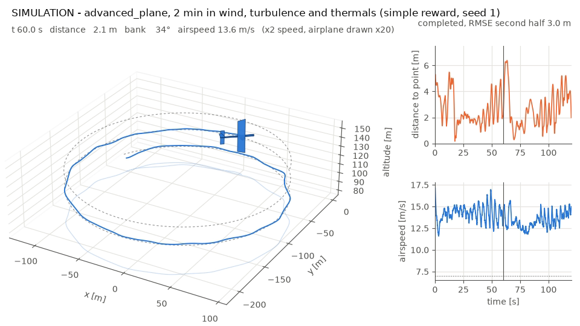
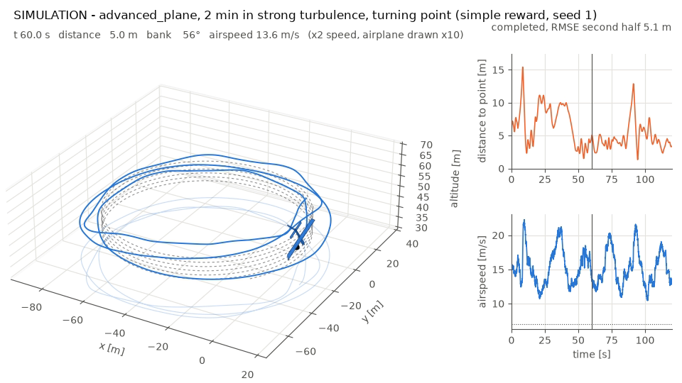
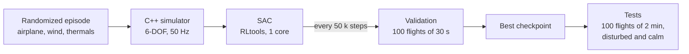

# Fixed-Wing: learning low-level fixed-wing control with the Learning to Fly recipe

| Wind, turbulence and thermals | Strong turbulence, turning point |
| --- | --- |
|  |  |

*Simulation. A SAC policy flies PX4's `advanced_plane` (blue) after a moving point (black, dashed path) for 2 minutes.
Right of each: distance to the point and airspeed. Energy weight 0, seed 1. Frames of 2-minute videos (not committed).*

MEng capstone at UC Berkeley, ARPL (Prof. Giuseppe Loianno). We apply the method of *Learning to Fly in Seconds*
(L2F) to a fixed-wing airplane: a fast C++ simulator, SAC, domain randomization. The policy flies the four control
surfaces at 50 Hz to follow a moving point in wind, turbulence, gusts and thermals. **Simulation only.**

## 1. The method, taken from L2F



- **Simulator.** 6-DOF rigid body, PX4's `advanced_plane` with the aerodynamic coefficients Gazebo uses for it,
  actuator lag, 0–2 steps of command latency, RK4. It is written in the structure of the L2F environment of
  [RLtools](https://github.com/rl-tools/rl-tools) (parameters, state, observe / reward / terminate), so RLtools trains
  on it as on its quadrotor. 8 M steps take about 35 min on one CPU core.
- **SAC with an asymmetric actor-critic.** The actor sees only quantities PX4 estimates (attitude, rates,
  velocity, airspeed, the error to the point), without noise for now, and its last 10 commands. The critics also see the true wind, the randomization
  factors and the latency. Critics updated every 10 steps and the actor every 20, as in the L2F paper.
- **Domain randomization.** Each episode draws a new airplane (mass ±10 %, thrust ±15 %, each aerodynamic
  coefficient ±10 %, latency 0–2 steps) and new air (below).
- **Training loop.** 30 s episodes, 8 M steps. When a reward weight changes, the rewards stored in the replay buffer
  are recomputed, as in L2F.
- **Checkpoints.** Every 50 k steps the actor flies 100 validation flights. After 1 M steps, we keep the most precise one
  among those that complete at least 97 % of them.
- **Evaluation.** The kept actor flies 100 test flights of 2 minutes (4 times the training episode) from fixed starts,
  airplanes and air, once disturbed and once in calm air. We report the share of flights completed and the position
  RMSE of the completed flights.

Details: [docs/method.md](docs/method.md).

## 2. What we did: follow a moving point with a simple reward

The point starts within 5 m of the airplane and flies at 12–18 m/s, straight in half the flights and turning (5–30°
of equivalent bank) in the other half. The reward is the L2F reward of RLtools, in meters, plus an energy term:

$$r = 35 - \left( \lVert p - p_{\text{ref}} \rVert + \lVert a_t - a_{t-1} \rVert + w_E \left( \frac{T}{T_{\max}} \right)^{3/2} \right)$$

and $r = -100$ on the step that ends the flight: more than 30 m from the point, angle of attack outside −15° to 18°,
airspeed outside 7–30 m/s, or below 20 m. $p$ is the airplane's position, $a_t$ the four commands, $T / T_{\max}$
the thrust over its maximum. The constant 35 is larger than any cost in flight, so flying always pays more than
crashing (with L2F's 0.5, the policy learns to crash).

Each episode draws its air: wind 0–6 m/s, Dryden turbulence from none to moderate, "1 − cos" gusts up to 3 m/s, and in
half the episodes a field of drifting Allen thermals (cores 0.5–3 m/s, radius 30–80 m, with a sinking ring).

## 3. Results

Savio job 41645214: three energy weights $w_E$, 4 seeds each, 8 M steps. Best checkpoint of each run, 100 test
flights of 2 minutes. "Disturbed": wind, turbulence and gusts in all flights, thermals in 42 of them.

| $w_E$ | Disturbed: completed | Position RMSE | With thermals | Without thermals | Calm: completed | Position RMSE | Energy per flight |
| --- | --- | --- | --- | --- | --- | --- | --- |
| 0 | 88 % | 6.4 m | 79 % | 94 % | 99.8 % | 6.1 m | 1.41 kJ |
| 0.1 | 89 % | 7.4 m | 80 % | 95 % | 99.8 % | 7.0 m | 1.38 kJ |
| 0.3 | 86 % | 5.8 m | 74 % | 95 % | 100 % | 5.4 m | 1.37 kJ |

Mean over 4 seeds; energy in the disturbed tests. Every run, with its range across seeds:
[docs/RESULTS.md](docs/RESULTS.md). Files: [`cpp/results/simple_px4plane`](cpp/results/simple_px4plane/README.md).

- Every run completes 84–90 % of the disturbed flights and 99–100 % of the calm ones.
- Thermals cause most failures: 22 % of the flights with thermals fail, 5 % of those without.
- The position error is 4–12 m depending on the seed (mean 6.5 m), close to the same in calm air.
- The energy term changes the energy by less than 3 %, less than the spread between seeds.

## 4. Where it stands

**Solid:**
- the method and the simulator: the C++ simulator matches the Python one to 7e-13 over 7,136 steps, the wind models
  match to 2e-14, and each of the 12 runs learns to fly the task;
- 99–100 % of calm flights and 84–90 % of disturbed flights completed, for all 12 runs.

**Not yet solid:**
- the airplane moves a lot and oscillates around the point (the right plot of each frame);
- the position error is 4–12 m (the precision recipe of the archive reached 1.4 m, in calm air only);
- thermals are the main cause of failure;
- nothing is validated outside our simulator: these policies are not flown yet in PX4 SITL / Gazebo or on a real
  airplane.

## Run it

On a Slurm cluster, from `cpp/` (CMake fetches a fixed RLtools commit; Intel MKL or OpenBLAS):

```bash
source slurm/setup.sh                          # login node: modules, MKL, configure
sbatch slurm/build.slurm                       # compile and check the C++ port against Python
sbatch slurm/tracking_px4plane_simple.slurm    # the 12 runs above: 3 energy weights x 4 seeds, 8 M steps
```

The options of one run are in that Slurm file. Targets, options and the PX4 SITL node: [cpp/README.md](cpp/README.md).
Python simulator and its 51 tests: [`python/`](python).

## Archive

Before this simple reward, we tried many reward variants on the same airplane in calm air: a precision recipe with a
closeness bonus and a reward curriculum (1.4 m), points that accelerate, the E-flite UMX Eratix with a tanh reward,
and a first task (hold airspeed, altitude and course) against a PID. Their results:
[docs/archive](docs/archive/README.md). The precision and Eratix recipes still build; every other variant, with its
code, Slurm files and results, is in git tag `experiments-2026-11`.

## Credits

L2F and RLtools: J. Eschmann, D. Albani, G. Loianno, "Learning to Fly in Seconds", RA-L 2024
([arXiv:2311.13081](https://arxiv.org/abs/2311.13081)), [rl-tools/rl-tools](https://github.com/rl-tools/rl-tools).
Dryden parameters: Beard and McLain, *Small Unmanned Aircraft*, 2012. Thermals: M. J. Allen, AIAA 2006-1510.
`advanced_plane`: PX4 Gazebo models. Python SAC: [stable-baselines3](https://github.com/DLR-RM/stable-baselines3).

Clément Dumeril, [clement.dumeril.net](https://clement.dumeril.net). MIT license ([LICENSE](LICENSE)); citation in
[CITATION.cff](CITATION.cff).
