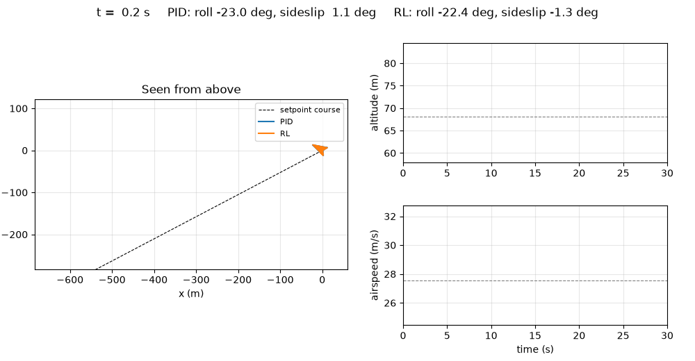

# Fixed-wing simulator and low-level RL controller

A NumPy fixed-wing simulator built on the structure of L2F (RLtools), with a Gymnasium task in which a SAC policy flies
the control surfaces directly. Latest result: 3 of 3 seeds learn to hold airspeed, altitude and course in wind and
turbulence, the best one completes 99 of 100 test flights against 97 for a PID, but on average SAC is still below the PID.



I started this in October 2026 for my MEng capstone at UC Berkeley, at ARPL (Prof. Giuseppe Loianno), on
reinforcement learning for the lab's Strix fixed-wing UAV. The research question: for sim-to-real transfer of a
low-level policy, how much does a faithful model help compared with wide domain randomization? This repository is the
simulator and training side. The airplane is still a placeholder (Aerosonde) until the Strix model is available.

## Results

Two series of 3 seeds, 1 M steps each, 3.4 to 4.2 h per seed on 8 cores of Savio. Every pilot flies the same 100 test
scenarios (seeds 0 to 99; training uses other seeds). Windy: wind up to 5 m/s, light Dryden turbulence, sensor noise.
Source: [`results/sac_gated_curriculum`](python/results/sac_gated_curriculum/README.md).

| 100 test scenarios | PID, calm | SAC, calm | PID, windy | SAC, windy |
| --- | --- | --- | --- | --- |
| Complete flights | 100 | 90 ± 3 | 97 | 92 ± 7 (best 99) |
| Mean return (max 1500) | 1322 | 1163 ± 21 | 1238 | 1197 ± 70 (best 1268) |
| Airspeed RMS error | 0.37 m/s | 0.55 m/s | 0.78 m/s | 0.59 m/s |
| Altitude RMS error | 0.68 m | 2.33 m | 1.34 m | 1.73 m |
| Course RMS error | 0.0° | 4.4° | 0.1° | 3.6° |

SAC responds faster with less overshoot and, in wind, **holds airspeed better than the PID on every seed**. **Three defects**
remain, each with a cause I could identify:

- Most failures are stalls in the first 5 s: from a perturbed start and a course change of up to 90°, the policy
  banks to 50 to 80° and pulls. The PID limits its bank to 30°; the reward never asks for a margin to the stall.
- Steady offsets of 2 to 4° in course and about 2 m in altitude: an MLP without memory has no integral action.
- Chattering commands in wind: 15 to 23 times the PID's command change per step.

The C++ port (RLtools, calm air) then gave the best policy so far, with the same settings on one Savio core: 97 of
100 flights, a mean return of 1335 against 1322 for the PID, airspeed within 0.23 m/s against 0.37, course within
1.7°. The PID still completes every flight and holds altitude better (0.68 against 0.99 m). A sweep of network and
batch sizes shows the critic size decides: with 256 units the policy learns in 70 to 140 min on one core, with 64 (the
L2F size) it never learns the course. Source: [`cpp/results/sweep`](cpp/results/sweep/README.md).

Getting here took three reward fixes. The first run ([`results/sac_run1`](python/results/sac_run1/README.md))
completed 98 flights but flew 25° banked in a 9° sideslip, because the reward penalized neither; I added a sideslip
and a distance-to-trim term. The L2F curriculum then broke learning twice: a command-change weight of 50 let
exploration noise alone saturate the cost, and with a fixed schedule the weights reached their target before the
policy could turn, so the capped reward was flat beyond 18° of course error and the policy unlearned. The reward now
has a linear far-field term, and the curriculum only advances when the course error is below 15°.

## What I built

- Simulator (`python/fixed_wing/airplane/`): the L2F skeleton (`Parameters` / `State` / dynamics, RK4,
  post-integration) ported to NumPy with fixed-wing physics: 6-DOF rigid body, linear aerodynamics (28 coefficients),
  first-order actuator lag, command latency, RK4 substeps and a Newton trim solver.
- Wind: constant wind, "1 − cos" gust, Allen's thermal model (NASA, AIAA 2006-1510) and Dryden turbulence
  discretized exactly, so its statistics do not depend on the control rate.
- RL task (`environment.py`, Gymnasium): hold an airspeed, an altitude and a course from a perturbed start. The
  actor sees only what PX4 estimates plus its last 10 actions; the critic also sees angle of attack, sideslip, the true
  wind and the randomization factors. Survival-bonus reward with a gated curriculum that recomputes the replay buffer.
- Baseline and evaluation: a cascaded PID (`pid.py`) using the same measurements as the actor, one `evaluate`
  function for every pilot, and a diagnosis of attitude in straight flight and of every failure
  (`examples/diagnose_flights.py`).
- Training and visualization: SAC with stable-baselines3 and an asymmetric policy (`asymmetric_sac.py`), Savio job
  files, learning curves, GIFs, and a live 3D viewer that flies one airplane or 36 at once.
- C++ port ([`cpp/`](cpp/README.md)): the airplane and the task in the MDP form of RLtools, trained with its SAC.
  It **matches the Python environment step by step** (7136 steps, states within 7e-13) and, with the same network sizes,
  learns better than the Python runs, on one core instead of eight. Savio jobs for a size sweep.

Inherited: the L2F structure and its quaternion and RK4 helpers (translated to Python), the ui-server protocol, and the
Aerosonde coefficients from Beard and McLain.

## How it works

The policy outputs aileron, elevator, rudder and throttle commands in [−1, 1] at 50 Hz. Each step earns
`r = 1 − 0.5 tanh(J / 0.5) − 0.1 Σ min(|e| / f, 1)`. `J` sums squared, scaled errors on airspeed, altitude, course and
sideslip, command changes, and the distance of the commands to trim; the last term keeps a slope far from the setpoint
(scales `f`: 10 m/s, 50 m, 90°). A step in flight always earns at least 0.2, so ending the episode never pays. Episodes
end below 20 m, outside 15 to 40 m/s, 50 m from the altitude setpoint, or with angle of attack outside [−10°, 15°],
since the linear model has no stall.

## How I checked it

- 51 tests (`pytest`): trim equilibrium, control signs, a constant wind that only shifts the trajectory, the Allen
  check case (outer radius 79.4 m, 5 updrafts per km²), Dryden variance and correlations, latency, substeps, the
  Gymnasium environment checker, reward recomputation matching the environment reward, and the gated curriculum.
- Flight performance against published Strix numbers ([`PARAMETERS.md`](python/PARAMETERS.md)): the placeholder
  glides at 15.7 against 7.9, so it has about half the Strix drag.
- The PID shows the task is feasible before any training.
- Before each run I check how often the reward is nearly flat under exploration noise, with pilots that do not track
  yet (`examples/reward_saturation.py`). This is the check that would have caught the curriculum failure.

## Limitations

- Aerosonde placeholder, not the Strix, and linear aerodynamics without stall.
- Nominal airplane: no parameter randomization yet, so the results do not yet address the research question.
- Three seeds per condition. Success varies by up to 14 flights between seeds and by about 10 between checkpoints of
  one seed, so small differences between variants are not significant.
- The Python simulator runs about 350 steps/s per core. The C++ port simulates over 300 000 steps/s, but in calm air
  only so far, and its training time is set by the critic: the 256 critic it needs takes 70 to 140 min per run.
- I have not isolated why the C++ runs learn better than the Python ones with the same settings.
- No flight test yet.

## Status

- [x] Simulator, wind models, comparison with published Strix numbers
- [x] RL environment, PID baseline, first SAC policy
- [x] Reward fixes, 3 seeds in calm air and 3 in wind, turbulence and sensor noise
- [x] C++ port with RLtools, checked against Python (calm air)
- [x] Network and batch size sweep in C++ (calm air)
- [ ] Wind, turbulence and sensor noise in C++
- [ ] Angle-of-attack margin, integral of the tracking errors, smoother commands
- [ ] Domain randomization, MLP against GRU policies
- [ ] Strix model, then trajectory tracking to compare with the lab's NMPC

## Reproduce

```bash
cd python
python -m venv ~/.venvs/fixed-wing && source ~/.venvs/fixed-wing/bin/activate
pip install -e ".[dev,rl]"
pytest                                   # about 1 min
python examples/pid_baseline.py          # PID on the 100 test scenarios, about 6 min
python examples/train_sac.py --steps 1000000 --n-envs 8 --out runs/sac   # about 4 h on 8 cores
python examples/train_sac.py --steps 1000000 --n-envs 8 --wind-max 5 --turbulence light --noise 1 --out runs/sac_windy
```

C++ (RLtools): [`cpp/README.md`](cpp/README.md). On Savio: [`python/savio/README.md`](python/savio/README.md). Figures and GIFs: `examples/plot_training.py`,
`compare_flights.py`, `make_videos.py`, `make_3d_videos.py`, `diagnose_flights.py`. Setup details and the viewer:
[`python/README.md`](python/README.md). Changes from L2F: [`python/DIFFERENCES_L2F.md`](python/DIFFERENCES_L2F.md).

## Credits

- L2F simulator and RLtools: J. Eschmann, D. Albani, G. Loianno, "Learning to Fly in Seconds", RA-L 2024
  ([arXiv:2311.13081](https://arxiv.org/abs/2311.13081)), [rl-tools/rl-tools](https://github.com/rl-tools/rl-tools),
  and the [ui-server](https://github.com/rl-tools/ui-server) viewer.
- Aerosonde parameters, Dryden gust parameters: R. Beard and T. McLain, *Small Unmanned Aircraft*.
- Thermal model: M. J. Allen, "Updraft Model for Development of Autonomous Soaring Uninhabited Air Vehicles", AIAA
  2006-1510.
- SAC implementation: [stable-baselines3](https://github.com/DLR-RM/stable-baselines3).
- MEng capstone at ARPL, UC Berkeley, advised by Prof. Giuseppe Loianno.

Clément Dumeril, [clement.dumeril.net](https://clement.dumeril.net). MIT license.
