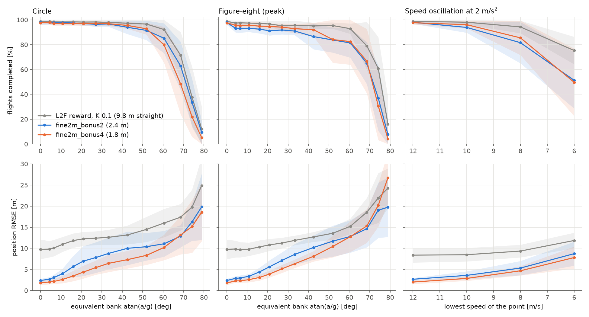

# Tracking a point that accelerates: the fine-observation actors (Savio, 10 November 2026)

The suite of [`reference_suite`](../reference_suite/README.md) (same motions, levels, starts and 100 flights per
level), flown by the best checkpoints of the two most precise runs on the straight line
([`fine_px4plane`](../fine_px4plane/README.md)), both trained only on points that fly straight:

- `fine2m_bonus4`: fine position observation (2 m), adaptive closeness bonus of weight 4 (third run, job 41045217),
  1.8 m on the straight line;
- `fine2m_bonus2`: the same with weight 2 (second run, job 41037545), 2.4 m, commands twice smoother.

Job 41088941 (build) and `slurm/reference_suite_fine.slurm`, with `evaluate_reference_fine` (the evaluator built with
the 65 inputs of the fine observation). On the straight line it reproduces the training runs' tests (seed 0 of
`fine2m_bonus4`: 97 %, 2.546 m on test A, as `evaluation_best.json`).

```bash
build/evaluate_reference_fine <run>/best_actor.h runs/reference_suite_fine/<name> --flights 100 --record 3 --fine-position-scale 2
python tools/plot_reference_suite.py results/reference_suite_fine/<name> runs/reference_suite_fine/<name>_seed*
python tools/plot_reference_compare.py results/reference_suite_fine/compare.png "<label>=results/reference_suite/summary.csv" ...
```



## Results (level starts, 10 seeds, mean ± std; RMSE over the second half of the completed flights)

| Motion | a [m/s²] | Bank | At 15 m/s | L2F reward, K 0.1: completed, RMSE | `fine2m_bonus2` | `fine2m_bonus4` |
| --- | --- | --- | --- | --- | --- | --- |
| straight | 0 | 0° | – | 99 %, 9.8 ± 2.3 m | 98 %, 2.4 ± 0.4 m | 98 %, **1.8 ± 0.5 m** |
| circle | 0.75 | 4° | R 300 m | 99 %, 9.8 ± 1.9 m | 98 %, 2.7 ± 0.5 m | 98 %, **2.0 ± 0.6 m** |
| circle | 1.9 | 11° | R 120 m | 98 %, 10.9 ± 1.8 m | 98 %, 4.0 ± 1.2 m | 97 %, **2.6 ± 0.9 m** |
| circle | 3.75 | 21° | R 60 m | 98 %, 12.2 ± 1.6 m | 97 %, 7.0 ± 3.5 m | 97 %, **4.4 ± 1.5 m** |
| circle | 9 | 43° | R 25 m | 97 %, 13.2 ± 2.2 m | 94 %, 10.0 ± 4.0 m | 96 %, **7.3 ± 2.1 m** |
| circle | 17.3 | 60° | R 13 m | **92 %**, 16.0 ± 3.4 m | 85 %, 11.1 ± 3.1 m | 80 %, 10.2 ± 3.0 m |
| circle | 25 | 69° | R 9 m | **72 %**, 17.4 ± 3.1 m | 63 %, 12.9 ± 2.6 m | 48 %, 13.2 ± 4.6 m |
| figure-eight | 0.75 | 4° | period 272 s | 97 %, 9.8 ± 2.0 m | 93 %, 2.9 ± 0.5 m | 96 %, **2.3 ± 0.4 m** |
| figure-eight | 3.75 | 21° | period 54 s | 97 %, 10.8 ± 1.4 m | 91 %, 5.6 ± 1.5 m | 95 %, **3.9 ± 0.8 m** |
| figure-eight | 9 | 43° | period 23 s | 95 %, 12.7 ± 1.2 m | 86 %, 10.2 ± 2.9 m | 92 %, **8.1 ± 1.2 m** |
| figure-eight | 25 | 69° | period 8 s | **79 %**, 18.6 ± 3.4 m | 65 %, 14.6 ± 4.4 m | 67 %, 15.3 ± 4.0 m |
| speed 12–18 | 2 | – | period 9.4 s | 99 %, 8.4 ± 1.8 m | 98 %, 2.7 ± 0.3 m | 98 %, **2.0 ± 0.5 m** |
| speed 12–18 | 8 | – | period 2.4 s | 99 %, 7.8 ± 2.0 m | 98 %, 4.2 ± 1.7 m | 98 %, **3.0 ± 0.9 m** |
| speed at 2 m/s² | 2 | – | 8–22 m/s | **94 %**, 9.3 ± 1.5 m | 82 %, 5.3 ± 1.7 m | 86 %, 4.7 ± 1.1 m |
| speed at 2 m/s² | 2 | – | 6–24 m/s | **75 %**, 11.8 ± 1.9 m | 51 %, 8.7 ± 2.8 m | 50 %, 7.8 ± 2.6 m |

Every level, both starts, with the along-track, cross-track and vertical offsets and the failure causes:
`<name>/summary.csv`; per seed: `<name>/per_seed/*.json`; figures of each run: `<name>/success_rmse.png`,
`trajectories.png`, `circle_limits.png`. Random starts give the same picture (within 1-3 %, `summary.csv`).

## What it shows

- **The precision gained on the straight line carries over to points that accelerate, but shrinks as they
  accelerate**. `fine2m_bonus4` follows circles at 2.0 m (R 300 m), 2.6 m (R 120 m), 4.4 m (R 60 m) and 7.3 m
  (R 25 m, 43° of bank), against 9.8-13.2 m for the first L2F reward; figure-eights and speed changes alike.
- **The error added by the acceleration is a lag**: on circles the airplane flies 0.8 m behind the point on the
  straight line, 2.2 m at 21° of bank, 5.6 m at 43° (`along_track_mean`), and 2 m above it at 43°. The policy
  observes the point's position and velocity, not its acceleration, and was never trained on a turning point.
- **The breaking point comes earlier**: at 60° of bank 80 % of the circles are completed against 92 % for the first
  L2F reward, at 69° 48 % against 72 %. The flights end at the angle-of-attack limit (78 % of the ends at 69°), half
  of them in the first 5 s while the airplane joins a point already turning hard. Weight 2 sits in between (63 %).
- **Slow points break it earlier too**: when the point slows to 8 m/s, 86 % complete against 94 %; to 6 m/s, 50 %
  against 75 %, nearly all on the 7 m/s airspeed limit (370 of 503 ends): it follows the point's speed down more
  closely than the first L2F reward did.
- Within 12-18 m/s, speed changes never break it at any rate up to 8 m/s², as for the first L2F reward.

## Not done

Training on accelerating points (the next step of [`reference_suite`](../reference_suite/README.md)), and giving the
policy the point's acceleration or its position a second ahead, to remove the lag and keep it on the hardest turns.
