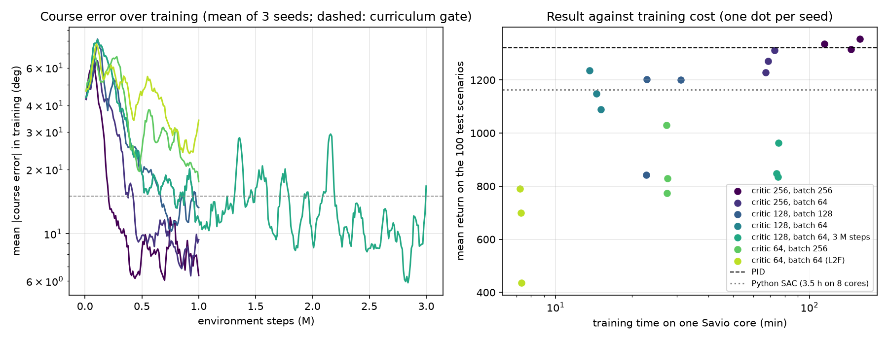

# Network and batch size sweep in C++ (Savio jobs 40480186 and 40498924, 24-25 October 2026)

SAC from RLtools on the C++ port, calm air, nominal airplane, same reward, curriculum gate and actor (64-64) as the
Python runs; only the critic hidden size and the batch size change. 1 M steps, 3 seeds each, one core of a Savio
`savio4_htc` node with Intel MKL, evaluated on the 100 test scenarios of the Python environment.

| Critic, batch | Time (1 core) | Curriculum stage | Complete flights | Mean return | Airspeed RMS | Altitude RMS | Course RMS | Command change |
| --- | --- | --- | --- | --- | --- | --- | --- | --- |
| critic 256, batch 256 | 140 min | 5, 5, 5 | 97 % | 1335 | 0.23 m/s | 0.99 m | 1.7° | 0.0034 |
| critic 256, batch 64 | 70 min | 5, 5, 5 | 97 % | 1270 | 0.42 m/s | 2.19 m | 3.9° | 0.0035 |
| critic 128, batch 128 | 26 min | 2, 3, 1 | 96 % | 1082 | 0.89 m/s | 4.58 m | 10.4° | 0.0877 |
| critic 128, batch 64 | 14 min | 3, 1, 2 | 96 % | 1158 | 0.77 m/s | 4.83 m | 10.2° | 0.0321 |
| critic 128, batch 64, 3 M steps | 75 min | 5, 5, 5 | 86 % | 882 | 1.83 m/s | 6.13 m | 28.5° | 0.0116 |
| critic 64, batch 256 | 27 min | 0, 0, 0 | 96 % | 878 | 1.93 m/s | 7.42 m | 16.2° | 0.0779 |
| critic 64, batch 64 (L2F) | 7 min | 0, 0, 0 | 69 % | 642 | 2.30 m/s | 15.54 m | 37.3° | 0.1617 |
| Python SAC, critic 256, batch 256 | 3.5 h on 8 cores | 5, 5, 5 | 90 % | 1163 | 0.55 m/s | 2.33 m | 4.4° | 0.0062 |
| PID | | | 100 % | 1322 | 0.37 m/s | 0.68 m | 0.0° | 0.0009 |

Mean over the seeds. Made with `tools/plot_sweep.py results/sweep`, which also draws `sweep.png`.

## What it shows

- **The critic size decides.** With a 256 critic every seed tracks the course early, the curriculum reaches its last
  stage and the policy holds airspeed, altitude and course; with 128 the curriculum stalls at stages 1 to 3, and
  with 64 it never moves.
- **The C++ run with the Python settings is the best policy so far**: a mean return of 1335 against 1322 for the PID,
  airspeed held better (0.23 against 0.37 m/s), course within 1.7°, and commands as calm as the PID's within a factor
  of four. It is not better than the PID everywhere: 3 of 100 flights still end in a stall, and the PID holds altitude
  better (0.68 against 0.99 m).
- **Batch 64 halves the cost of a 256 critic** (70 instead of 140 min) for a small loss (return 1270, course 3.9°).
- **Training a small critic longer does not help.** Critic 128 for 3 M steps reaches the last curriculum stage, then
  degrades: 86 % of the flights, 28.5° of course error. With the final, stricter weights the small critic does not
  keep up.
- **Same settings, better than Python.** The C++ 256 x 256 run beats the Python one on every metric (return 1335
  against 1163). The two SAC implementations differ in details (stable-baselines3 against RLtools), and the C++ run
  steps one airplane at a time where the Python run stepped eight. I have not isolated the cause yet.

## Next

Critic 256 with batch 64 as the default C++ configuration, then the three defects of the Python runs (early stalls,
steady offsets, jittery commands in wind), which the 256 runs now let me test in about an hour each.

## Files

`<variant>_seed<k>/`: `progress.csv` and `evaluation.json` of each run, from `savio/sweep.slurm` and, for the 3 M-step
runs, `sbatch --array=0-2 savio/train.slurm train_sac_c128_b64 3000000`.
