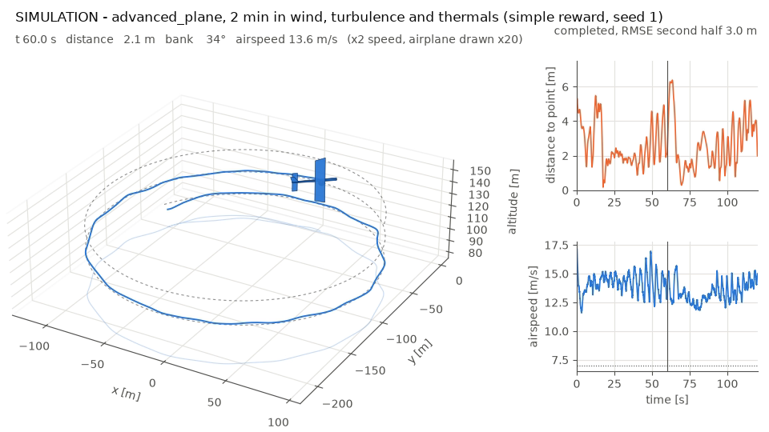
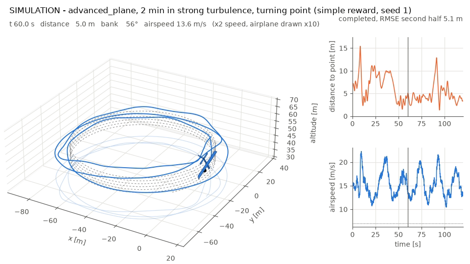

# Results: simple reward in wind and thermals

Detail behind the [README](../README.md). Method and test protocol: [method.md](method.md). Every number below comes
from the committed files in [`cpp/results/simple_px4plane`](../cpp/results/simple_px4plane/README.md). Earlier
results (the calm-air precision recipe, points that accelerate, the Eratix, the first task against a PID, and the
numbers on the poster) are in the [archive](archive/README.md).

Savio job 41645214, `cpp/slurm/tracking_px4plane_simple.slurm`: PX4's `advanced_plane`, energy weights
$w_E \in \lbrace 0, 0.1, 0.3 \rbrace$, 4 seeds each, 8 M steps per run. Best checkpoint of each run. Each test is 100
flights of 120 s. Disturbed: wind, turbulence and gusts in every flight, thermals in 42 of the 100. Calm: no
disturbance.

## Every run

| $w_E$ | Seed | Disturbed: completed | RMSE | Energy | With thermals | Without thermals | Calm: completed | RMSE | Energy | Best checkpoint |
| --- | --- | --- | --- | --- | --- | --- | --- | --- | --- | --- |
| 0 | 0 | 90 % | 6.1 m | 1.39 kJ | 83 % | 95 % | 100 % | 6.1 m | 1.03 kJ | 1.70 M |
| 0 | 1 | 85 % | 4.2 m | 1.13 kJ | 76 % | 91 % | 100 % | 3.6 m | 1.01 kJ | 3.75 M |
| 0 | 2 | 90 % | 4.8 m | 1.49 kJ | 81 % | 97 % | 99 % | 4.7 m | 1.28 kJ | 3.85 M |
| 0 | 3 | 86 % | 10.4 m | 1.64 kJ | 74 % | 95 % | 100 % | 9.8 m | 1.34 kJ | 2.65 M |
| 0.1 | 0 | 90 % | 11.6 m | 0.96 kJ | 83 % | 95 % | 100 % | 11.1 m | 0.77 kJ | 1.00 M |
| 0.1 | 1 | 87 % | 8.2 m | 1.52 kJ | 74 % | 97 % | 99 % | 8.0 m | 1.31 kJ | 2.55 M |
| 0.1 | 2 | 90 % | 5.3 m | 1.64 kJ | 83 % | 95 % | 100 % | 5.0 m | 1.45 kJ | 4.30 M |
| 0.1 | 3 | 87 % | 4.5 m | 1.39 kJ | 79 % | 93 % | 100 % | 4.0 m | 1.10 kJ | 6.05 M |
| 0.3 | 0 | 84 % | 4.7 m | 1.51 kJ | 76 % | 90 % | 100 % | 4.6 m | 1.22 kJ | 3.00 M |
| 0.3 | 1 | 88 % | 6.8 m | 1.21 kJ | 79 % | 95 % | 100 % | 6.3 m | 1.03 kJ | 4.15 M |
| 0.3 | 2 | 89 % | 6.1 m | 1.50 kJ | 76 % | 98 % | 100 % | 6.1 m | 1.13 kJ | 3.95 M |
| 0.3 | 3 | 84 % | 5.5 m | 1.27 kJ | 67 % | 97 % | 100 % | 4.7 m | 1.13 kJ | 5.95 M |

RMSE: position RMSE of the completed flights. Energy: per completed flight. Thermal columns: of the 42 flights with
thermals and the 58 without. Disturbed: `evaluation_best_disturbed.json`; calm: `evaluation_best_calm.json`; best
checkpoint: the step of the lowest score in `checkpoints.csv`.

## Means over the 4 seeds

| $w_E$ | Disturbed: completed | RMSE | Energy | With thermals | Without thermals | Calm: completed | RMSE | Energy |
| --- | --- | --- | --- | --- | --- | --- | --- | --- |
| 0 | 87.8 % | 6.4 m | 1.41 kJ | 78.6 % | 94.4 % | 99.8 % | 6.1 m | 1.17 kJ |
| 0.1 | 88.5 % | 7.4 m | 1.38 kJ | 79.8 % | 94.8 % | 99.8 % | 7.0 m | 1.16 kJ |
| 0.3 | 86.3 % | 5.8 m | 1.37 kJ | 74.4 % | 94.8 % | 100 % | 5.4 m | 1.12 kJ |
| all 12 runs | 87.5 % | 6.5 m | 1.39 kJ | 77.6 % | 94.7 % | 99.8 % | 6.2 m | 1.15 kJ |

## What the numbers say

- **The policies fly.** Every run completes 84–90 % of the disturbed flights and 99–100 % of the calm ones, on
  flights four times longer than the training episodes.
- **Thermals cause most failures.** Flights with thermals: 67–83 % completed (mean 77.6 %); without: 90–98 % (mean
  94.7 %). Over the 12 runs, 113 of the 504 flights with thermals fail (22 %) and 37 of the 696 without (5 %). The
  150 failed flights end at the airspeed limits (7–30 m/s, 72 flights), at the angle-of-attack limit (55), or more
  than 30 m from the point (23).
- **The position error is large and varies between seeds.** 4.2–11.6 m in disturbed air (mean 6.5 m, standard
  deviation 2.3 m over the 12 runs), 3.6–11.1 m in calm air (mean 6.2 m). Calm air barely lowers it, so most of the
  error does not come from the disturbances.
- **The airplane moves a lot.** The commands change by 0.02–0.21 per step on average in the disturbed tests (mean
  absolute change of each command, range $[-1, 1]$; field `mean_action_change`). In the 2-minute videos below, the
  distance to the point keeps swinging by a few meters and, in strong turbulence, the airspeed between about 11 and
  22 m/s.
- **The energy term does almost nothing.** From $w_E = 0$ to $0.3$ the energy per disturbed flight drops by less
  than 3 % (1.41 to 1.37 kJ), well inside the spread between seeds (0.96–1.64 kJ). The one economical policy
  ($w_E = 0.1$, seed 0, 0.96 kJ) is also the least precise (11.6 m).
- **The checkpoint choice matters.** The last actors complete 60–88 % of the disturbed flights (mean 80 %) and
  80–100 % of the calm ones (mean 97 %), with 5.1–10.1 m of RMSE in disturbed air (`evaluation_disturbed.json`,
  `evaluation_calm.json`). The kept checkpoints come from 1.0 M to 6.05 M steps. For one run ($w_E = 0$, seed 1) no
  checkpoint completed 97 % of the validation flights, so it was chosen by the fallback score
  ([method.md](method.md#checkpoints)).
- **Training time.** 33–36 min per run of 8 M steps on one Savio core (`progress.csv`, `time/time_elapsed`).

## Two flights

*Policy $w_E = 0$, seed 1. One frame each of two 2-minute videos, at 60 s; the plots on the right cover the whole
flight. Top: wind, turbulence and thermals, the point on a wide circle. Bottom: strong turbulence, the point on a
helix. Both flights are completed. The videos are not committed.*

## Limits of the best policy

[`limit_tests/`](limit_tests/README.md) pushes the energy 0, seed 1 policy past its training range, one change at a
time, 50 flights per level, in our simulator:

| test | trained on | still fine | breaks at |
| --- | --- | --- | --- |
| motor cut, then restart | never | 5 s (100 %, 8 m of altitude lost) | 10 s (68 %), 0 % from 30 s |
| headwind / crosswind / tailwind | 0-6 m/s | 10 / 10 / 2 m/s | 12 / 12 / 4 m/s |
| Dryden turbulence | up to 1 x moderate | 1 x (92 %) | 1.5 x (66 %) |
| thermal core | up to 3 m/s | 5 m/s | 6 m/s |
| latency | 0-40 ms | 80 ms | 100 ms (pitch limit cycle) |
| thrust | +-15 % | 0.18 x | 0.12 x |
| point jump | never | 20 m | 30 m |

The glide itself is clean (13-14 m/s, glide ratio 16-20). Longer cuts fail because the policy pulls up to hold
altitude and stalls, a state it never saw in training. The wind limits come from the allowed airspeed range
(7-30 m/s): when the task needs 10-28 m/s of airspeed, 98-100 % of the flights complete.

## Not tested yet

- These policies are not flown in PX4 SITL / Gazebo nor on a real airplane. The ROS 2 node of `cpp/deploy` is built
  for the 62-input actors of the archive, not for these 65-input ones.
- No sensor noise: the actor sees the true state, not PX4's estimate of it.
