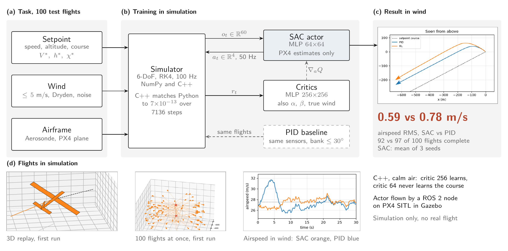
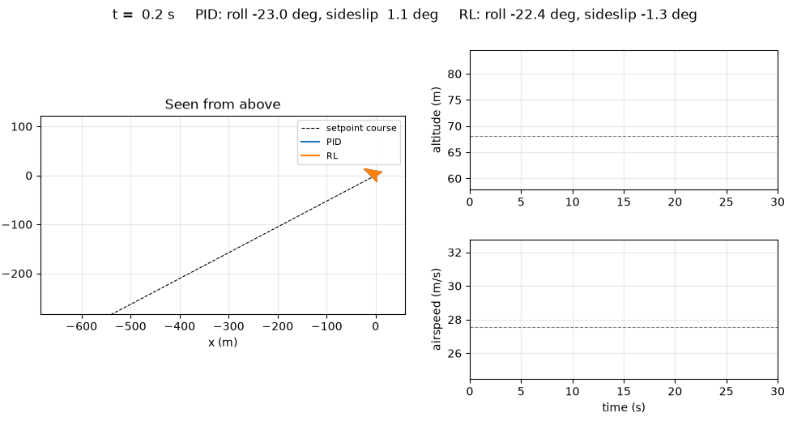

# Detailed results

Detail behind the [top-level README](../README.md). Reward, gated curriculum and checks: [method.md](method.md).
Components and figure scripts: [reproduce.md](reproduce.md). Every number below comes from the committed result
files named with it.

## The question

For sim-to-real transfer of a low-level fixed-wing policy, how much does a faithful model help compared with wide
domain randomization? This repository is the simulator and training side. The structure (parameters, state, RK4,
observe / reward / terminate) follows L2F from RLtools; the fixed-wing physics, wind models, task, PID baseline, C++
port and PX4 SITL deployment are mine. SAC uses an asymmetric actor-critic: the actor sees only what PX4 estimates, the
critics also see angle of attack, sideslip and the true wind.

## Following a moving point on PX4's advanced_plane (C++)

A reference point starts up to 50 m from the airplane and flies straight; the airplane has to reach it and follow it.
Test A: 100 flights per seed from a neutral start; random start: 100 flights from random starts
(`evaluation_best_random.json`). SAC, critic 128, L2F update
intervals and batch, L2F reward form, 4 M steps, best checkpoint, 10 seeds.

| 10 seeds, best checkpoint | Test A | Random start | Position RMS | Velocity RMS | Behind the point | Lateral RMS | Flights under 5 m |
| --- | --- | --- | --- | --- | --- | --- | --- |
| velocity correction K = 0.1 /s | 98.8 % | 96.4 % | 9.8 ± 2.3 m | 0.46 m/s | 5.9 m | 6.8 m | 9 % |
| velocity correction K = 0.3 /s (`guidance03`) | 98.7 % | 97.2 % | 6.6 ± 1.6 m | 0.28 m/s | 3.2 m | 4.6 m | 31 % |
| K = 0.3 /s, fine-scale error input + adaptive closeness bonus (`fine2m_bonus_adaptive`) | 98.0 % | 98.4 % | 4.9 ± 1.0 m | 0.49 m/s | | | 62 % |
| same, most precise checkpoint with >= 97 % validation success, bonus weight 2 (`fine2m_bonus2`) | 97.9 % | 95.8 % | 2.4 ± 0.4 m | 0.39 m/s | 0.8 m | 1.1 m | 96 % |
| same, bonus weight 4 (`fine2m_bonus4`) | 97.6 % | 96.8 % | 1.8 ± 0.5 m | 0.31 m/s | 0.9 m | 0.8 m | 97 % |
| same, 8M steps instead of 4M (`c128_8M`) | 98.4 % | 96.7 % | **1.4 ± 0.35 m** | | | | |

Source: [`cpp/results/precision_px4plane`](../cpp/results/precision_px4plane/README.md) (`guidance03/seed*/evaluation_best*.json`)
and [`cpp/results/l2f_reward_px4plane`](../cpp/results/l2f_reward_px4plane/README.md). That page also has the variants
that did not beat K = 0.3 on their own (linear distance cost, K = 0.5, closeness bonus, position-error integral).
± is the standard deviation over the 10 seeds (population).

The last row adds tanh(error / 2 m) to the observation (65 inputs) and the closeness bonus with an adaptive scale:
4.9 m, the same for the last actor (4.9 ± 1.3 m), 62 % of the test flights under 5 m and 12 % under 2 m. Neither change
helps alone (6.0-6.4 m with the fine input, 6.7-10.9 m with the bonus). What is left is a steady offset per flight
(2.4, 2.4 and 2.0 m behind, sideways and in altitude for the last actors) with 0.3-0.4 m of motion around it. Source:
[`cpp/results/fine_px4plane`](../cpp/results/fine_px4plane/README.md) (`fine2m_bonus_adaptive/seed*/evaluation_best*.json`).

The last two rows keep as best checkpoint the most precise one with at least 97 % validation success after 1 M steps
(`--checkpoint-precise 0.97 1000000`; 3.7 m with weight 1) and raise the closeness bonus weight: 2.4 m with weight 2,
1.8 m with weight 4 (seeds between 1.3 and 2.6 m, 78 % of the flights under 2 m). The steady offset drops to 1.0, 0.8
and 0.7 m with 0.1 m of motion around it; the cost is rougher commands (0.041 per step instead of 0.021 with weight 2),
and the last actors stay at 3.5 m. Source: [`cpp/results/fine_px4plane`](../cpp/results/fine_px4plane/README.md)
(`second_run/fine2m_bonus2`, `third_run/fine2m_bonus4`).

Training 8M steps instead of 4M takes the error to 1.4 ± 0.35 m (every seed between 1.1 and 2.3 m); the 8M runs repeat
the 4M runs step for step up to 4M, so the gain is from the extra steps. 95 % of the training time is the network
updates (2 % the airplane): critics of 64 or 32 neurons, as in L2F, train 1.7–2.7 times faster but give 3.1 m and
16 m. Source: [`cpp/results/speed_px4plane`](../cpp/results/speed_px4plane/README.md).

The same terms as norms instead of squares, as in RLtools' L2F reward (`--reward l2f-norm`), with the closeness bonus:
1.4 ± 0.45 m in 4M steps (16.7 min instead of 32), the last actors at 2.2 m instead of 3.5 m. Without the bonus the
norms give 3.9 m: they do not replace it. Source: [`cpp/results/reward_px4plane`](../cpp/results/reward_px4plane/README.md).

### Points that accelerate

Trained only on points that fly straight, `fine2m_bonus4` keeps most of its precision when the point turns or
changes speed: circles at 2.0 m (R 300 m), 4.4 m (R 60 m, 21° of bank) and 7.3 m (R 25 m, 43°), against 9.8, 12.2
and 13.2 m for the first L2F reward; the added error is a lag behind the point (5.6 m at 43°). It breaks earlier on
the hardest turns: 80 % of the circles completed at 60° of bank against 92 %, 48 % at 69° against 72 %, ending at
the angle-of-attack limit. Source: [`cpp/results/reference_suite_fine`](../cpp/results/reference_suite_fine/README.md)
(`compare.png`, `fine2m_bonus4/summary.csv`; the first L2F reward: [`reference_suite`](../cpp/results/reference_suite/README.md)).

Other C++ runs, each with its table and discussion: network and batch sweep
([`sweep`](../cpp/results/sweep/README.md)), batch 256 ([`batch_px4plane`](../cpp/results/batch_px4plane/README.md)),
3 M steps with the best checkpoint ([`long_px4plane`](../cpp/results/long_px4plane/README.md)), L2F update intervals
([`l2f_intervals_px4plane`](../cpp/results/l2f_intervals_px4plane/README.md)), L2F critic size and TD3
([`l2f_td3_px4plane`](../cpp/results/l2f_td3_px4plane/README.md)), smoothing TD3's commands
([`td3_smooth_px4plane`](../cpp/results/td3_smooth_px4plane/README.md)), the L2F reward form
([`l2f_reward_px4plane`](../cpp/results/l2f_reward_px4plane/README.md)), points that accelerate (circles,
figure-eights, speed changes: [`reference_suite`](../cpp/results/reference_suite/README.md)), and the first trainings
with the check against Python ([`cpp/results`](../cpp/results/README.md)).

## The lab's E-flite UMX Eratix

A first model from its specs, product photos and textbook aerodynamics, before any flight data
([eratix_model.md](eratix_model.md)). Same tracking task scaled to the airplane (point at 7-10 m/s, up to 20 m away),
SAC, critic 128, batch 256, L2F intervals, 4 M steps, 10 seeds.

| 10 seeds | Test A | Test B | Ahead | Position RMS | Velocity RMS | Command change |
| --- | --- | --- | --- | --- | --- | --- |
| Last actor | 85.9 ± 22.0 % | 84.7 % | 84.3 % | 11.9 m | 1.64 m/s | 0.421 |
| Best checkpoint | 99.2 ± 0.7 % | 96.7 % | 97.3 % | 7.9 ± 2.8 m | 1.11 m/s | 0.244 |

18 min per run; it flies (mean episode length at 90 % of the maximum) after 570 k steps, 2.4 min. Its commands are
rough (0.24 per step against 0.036 on the advanced_plane with the same recipe) and the last actors are unsteady, so
the best checkpoint is needed. Source: [`cpp/results/eratix`](../cpp/results/eratix/README.md).

## PX4 SITL in Gazebo

From [cpp/README.md](../cpp/README.md). The policy in `policy_weights.h` is seed 9 of the 400k-step critic-128 runs on
the advanced_plane (`tracking_px4plane`): in its SITL flight it followed the point at 20 m RMSE over the last 30 s,
and this simulator flies the same flight at 20 m, 6 m below the point in both. Seed 3, the first policy flown,
followed it at 15 m in Gazebo but 9 m in this simulator: its commands changed 10 times more from step to step, and
amplified the noise of PX4's estimate. On the first identification flight, the servos follow their command with
0.1 s of lag as modelled, and the step-by-step residuals have no bias (accelerations within 0.2 m/s² and
0.2 rad/s²). The SITL flight logs are not committed; the comparison figure is
[`long_px4plane/figures/test_flights.png`](../cpp/results/long_px4plane/figures/test_flights.png).

## First task: hold airspeed, altitude and course (Python and C++)

From a perturbed start, hold an airspeed (20 to 30 m/s), an altitude (±20 m) and a course (±90°) for 30 s. Every
pilot flies the same 100 test scenarios. Windy: constant wind up to 5 m/s, light Dryden turbulence, sensor noise. SAC
rows: mean ± std over 3 seeds, 1 M steps each.

In wind and turbulence, SAC holds airspeed better than a cascaded PID on all 3 seeds (0.59 against 0.78 m/s RMS) but
completes fewer of the 100 test flights on average (92 against 97).

| Pilot | Air | Complete / 100 | Return (max 1500) | Airspeed RMS (m/s) | Altitude RMS (m) | Course RMS (deg) |
| --- | --- | --- | --- | --- | --- | --- |
| PID | calm | 100 | 1322 | 0.37 | 0.68 | 0.0 |
| SAC, Python | calm | 90 ± 3 | 1163 ± 21 | 0.55 ± 0.22 | 2.33 ± 0.15 | 4.4 ± 2.1 |
| SAC, C++ critic 256 | calm | 97 ± 1 | 1335 ± 19 | 0.23 ± 0.06 | 0.99 ± 0.89 | 1.7 ± 1.0 |
| SAC, C++ critic 64 | calm | 69 ± 49 | 642 ± 184 | 2.30 ± 1.02 | 15.54 ± 12.70 | 37.3 ± 19.8 |
| PID | windy | 97 | 1238 | 0.78 | 1.34 | 0.1 |
| SAC, Python | windy | 92 ± 7 | 1197 ± 70 | 0.59 ± 0.05 | 1.73 ± 0.45 | 3.6 ± 0.9 |

Printed by `python examples/results_table.py` from the committed `evaluation.json` files of
[`python/results/sac_gated_curriculum`](../python/results/sac_gated_curriculum/README.md) and
[`cpp/results/sweep`](../cpp/results/sweep/README.md). On average the PID is still the better pilot; most SAC failures
are stalls in the first 5 s, from banking 50 to 80° where the PID limits its bank to 30°.

*Best windy SAC seed (seed 2) and the PID on test scenario 1, same wind and turbulence.*

## Limitations in detail

- Placeholder airframes (Aerosonde, PX4 `advanced_plane`), linear aerodynamics without stall: the angle-of-attack
  limit ends the episode instead (the Eratix model blends into a flat-plate model past a 12° stall). No parameter
  randomization in the reported runs, so the research question is not answered yet.
- First task: three seeds per condition; success varies by up to 14 flights between seeds, so small differences are
  not significant.
- The C++ port is trained in calm air only: wind, turbulence and sensor noise are not ported.
- No real flight.

## Run times and code map

Tested with Python 3.11 on Windows 10 and Linux. Dependencies are not pinned. `python examples/pid_baseline.py` (PID
on the 100 test scenarios) takes about 6 min; `python examples/train_sac.py --steps 1000000 --n-envs 8` about 4 h on
8 cores. The C++ build (CMake, fetches a fixed RLtools commit, Intel MKL or OpenBLAS), Slurm job files and the ROS 2
node are in [`cpp/README.md`](../cpp/README.md).

| Path | Content |
| --- | --- |
| `python/fixed_wing/airplane/` | simulator, wind, Gymnasium task and reward, PID baseline, asymmetric SAC |
| `python/examples/` | training, evaluation, diagnostics, plots, GIFs, 3D viewer |
| `python/tests/` | 51 tests (trim, control signs, wind statistics, reward recomputation) |
| `cpp/include/fixed_wing/`, `cpp/src/` | C++ port in the RLtools MDP form, SAC training, check against Python |
| `cpp/deploy/ros2/fw_policy/` | ROS 2 node that flies an exported actor on PX4 SITL over uXRCE-DDS |
| `python/slurm/`, `cpp/slurm/` | Slurm job files |
