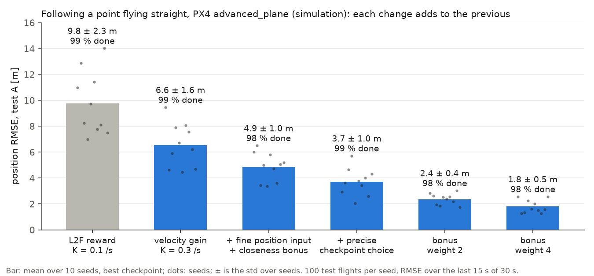
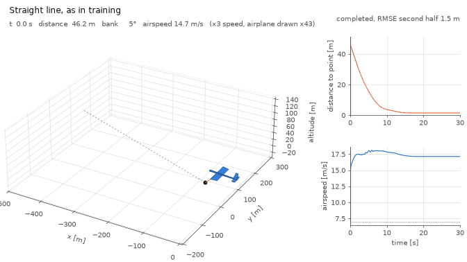
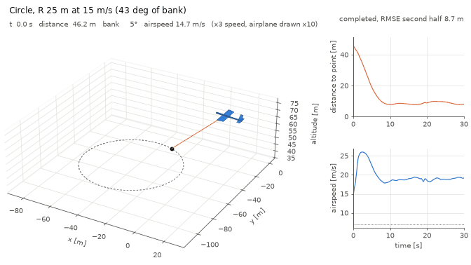
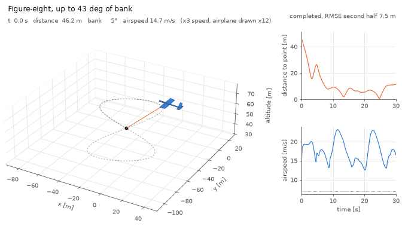
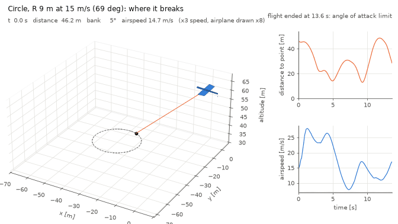
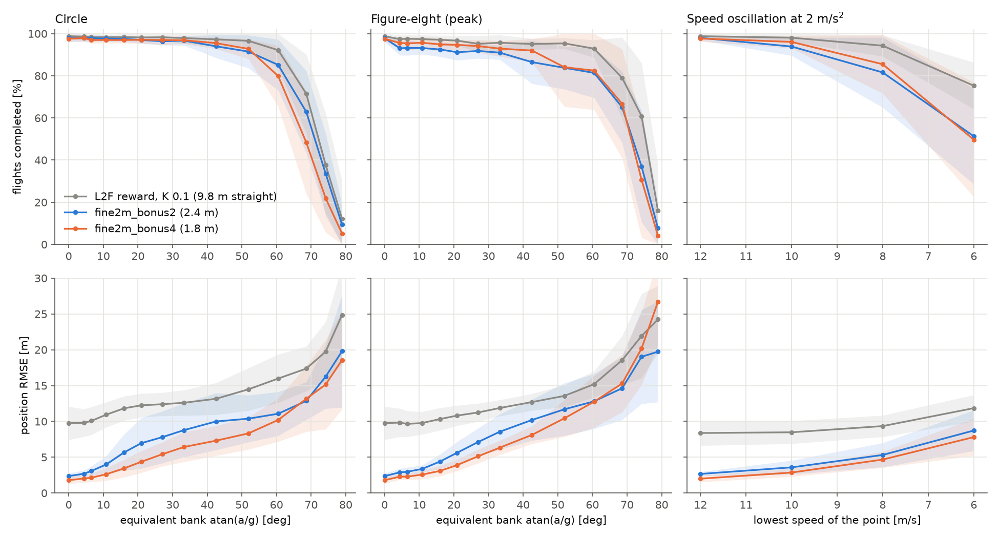
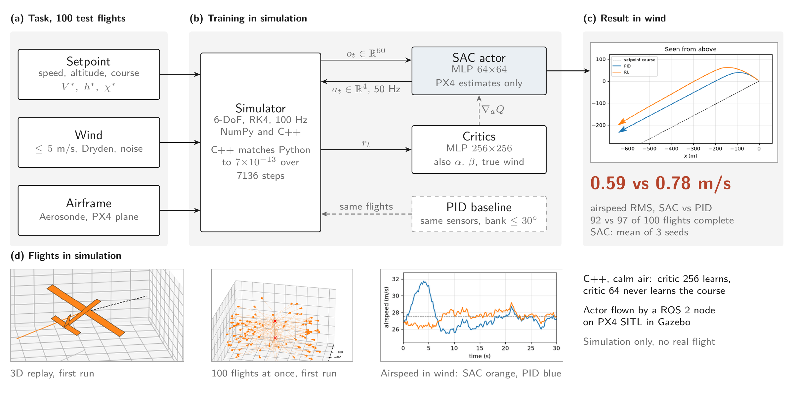
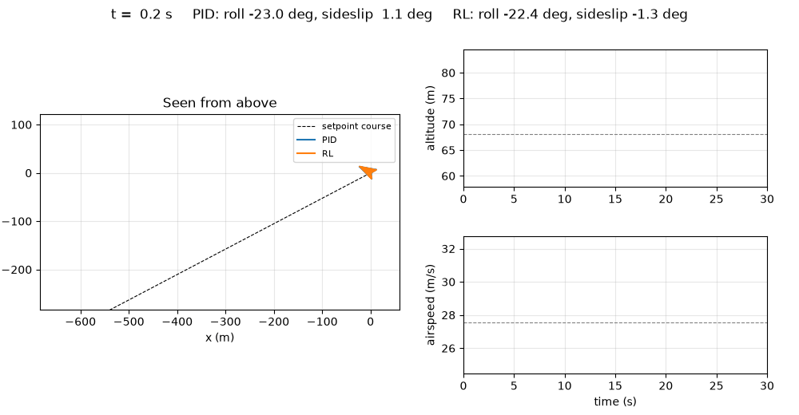

# Archive: earlier recipes and their results

The front page ([README](../../README.md)) shows one recipe: the simple L2F-form reward in wind and thermals. This
page keeps what came before it, with its results. All of it is in calm air unless written otherwise.

- **Code.** This branch still builds the precision recipe and the Eratix recipe (`cpp/README.md`). Every other variant
  (other network and batch sizes, TD3 and its smoothing, the L2F update intervals alone, the error integral, other
  reward forms, near starts, profiling) is in git tag `experiments-2026-11`, with its targets, options, Slurm files
  and results: `git checkout experiments-2026-11`.
- **Result files.** They stay at their paths in [`cpp/results`](../../cpp/results/README.md), because the figure
  scripts read them there. Each folder has its own README with the full table and discussion.
- Every number below comes from the committed result files named with it.

Contents: [precision recipe](#1-precision-recipe-advanced_plane-calm-air) ·
[points that accelerate](#2-points-that-accelerate) · [Eratix](#3-the-labs-e-flite-umx-eratix-tanh-reward) ·
[PX4 SITL](#4-px4-sitl-in-gazebo) · [first task](#5-first-task-hold-airspeed-altitude-and-course-python-and-c) ·
[limitations](#6-limitations-of-these-runs) · [first-task method](first_task_method.md)

## 1. Precision recipe (advanced_plane, calm air)

The same airplane follows a point that starts up to 50 m away and flies straight. Test A: 100 flights per seed from a
neutral start; random start: 100 flights from random starts (`evaluation_best_random.json`). SAC, critic 128, L2F
update intervals and batch, 4 M steps, best checkpoint, 10 seeds.

The reward is the L2F form with the norms of the errors, as the L2F reward of RLtools at b32d9985: 2 minus weighted
norms of the scaled position, velocity, sideslip, command change and stall margin, clipped at −2, a termination
penalty of $2 / (1 - \gamma)$, and a curriculum that grows the weights every 100 k steps. On top of it:

- a velocity target toward the point (gain $K$ = 0.3 /s);
- the position error also given to the actor on a fine 2 m scale, $\tanh(e / 2 \text{ m})$ (65 inputs);
- a closeness bonus $W \exp(-(d / s)^2)$, with $W = 4$ and a scale $s$ that shrinks with the training distance;
- the precise checkpoint choice: the most precise checkpoint with at least 97 % validation success after 1 M steps.

`slurm/tracking_px4plane_reward.slurm`: 1.4 ± 0.45 m RMS position error on test A and 98 % of the flights completed,
over 10 seeds, 16.7 min per run on a Savio core
([`reward_px4plane`](../../cpp/results/reward_px4plane/README.md), `norm_bonus4`). Options in
[cpp/README.md](../../cpp/README.md#the-precision-recipe).

*Script: `cpp/tools/plot_error_reduction.py`.*

| 10 seeds, best checkpoint | Test A | Random start | Position RMS | Velocity RMS | Behind the point | Lateral RMS | Flights under 5 m |
| --- | --- | --- | --- | --- | --- | --- | --- |
| velocity correction K = 0.1 /s | 98.8 % | 96.4 % | 9.8 ± 2.3 m | 0.46 m/s | 5.9 m | 6.8 m | 9 % |
| velocity correction K = 0.3 /s (`guidance03`) | 98.7 % | 97.2 % | 6.6 ± 1.6 m | 0.28 m/s | 3.2 m | 4.6 m | 31 % |
| K = 0.3 /s, fine-scale error input + adaptive closeness bonus (`fine2m_bonus_adaptive`) | 98.0 % | 98.4 % | 4.9 ± 1.0 m | 0.49 m/s | | | 62 % |
| same, most precise checkpoint with >= 97 % validation success, bonus weight 2 (`fine2m_bonus2`) | 97.9 % | 95.8 % | 2.4 ± 0.4 m | 0.39 m/s | 0.8 m | 1.1 m | 96 % |
| same, bonus weight 4 (`fine2m_bonus4`) | 97.6 % | 96.8 % | 1.8 ± 0.5 m | 0.31 m/s | 0.9 m | 0.8 m | 97 % |
| same, 8M steps instead of 4M (`c128_8M`) | 98.4 % | 96.7 % | 1.4 ± 0.35 m | | | | |
| norms instead of squares, bonus weight 4, 4M steps (`norm_bonus4`) | 98.2 % | 95.7 % | **1.4 ± 0.45 m** | | | | |

± is the standard deviation over the 10 seeds (population). Sources:
[`l2f_reward_px4plane`](../../cpp/results/l2f_reward_px4plane/README.md),
[`precision_px4plane`](../../cpp/results/precision_px4plane/README.md) (`guidance03/seed*/evaluation_best*.json`),
[`fine_px4plane`](../../cpp/results/fine_px4plane/README.md) (`fine2m_bonus_adaptive`, `second_run/fine2m_bonus2`,
`third_run/fine2m_bonus4`), [`speed_px4plane`](../../cpp/results/speed_px4plane/README.md) (`c128_8M`),
[`reward_px4plane`](../../cpp/results/reward_px4plane/README.md) (`norm_bonus4`).

- **Fine input and bonus.** Adding $\tanh(e / 2 \text{ m})$ to the observation and the closeness bonus gives 4.9 m.
  Neither change helps alone (6.0–6.4 m with the fine input, 6.7–10.9 m with the bonus). What is left is a steady
  offset per flight (2.4, 2.4 and 2.0 m behind, sideways and in altitude for the last actors) with 0.3–0.4 m of motion
  around it.
- **Precise checkpoint choice and bonus weight.** 3.7 m with weight 1, 2.4 m with weight 2, 1.8 m with weight 4
  (seeds between 1.3 and 2.6 m, 78 % of the flights under 2 m). The steady offset drops to 1.0, 0.8 and 0.7 m with
  0.1 m of motion around it. The cost is rougher commands (0.041 per step instead of 0.021 with weight 2), and the last
  actors stay at 3.5 m.
- **Longer training.** 8M steps instead of 4M give 1.4 ± 0.35 m (every seed between 1.1 and 2.3 m). The 8M runs
  repeat the 4M runs step for step up to 4M, so the gain is from the extra steps. 95 % of the training time is the
  network updates (2 % the airplane). Critics of 64 or 32 neurons, as in L2F, train 1.7–2.7 times faster but give
  3.1 m and 16 m.
- **Norms instead of squares**, as in RLtools' L2F reward (`--reward l2f-norm`), with the closeness bonus: 1.4 ± 0.45 m
  in 4M steps (16.7 min instead of 32), the last actors at 2.2 m instead of 3.5 m. Without the bonus the norms give
  3.9 m: they do not replace it.
- **Other variants** that did not beat K = 0.3 on their own (linear distance cost, K = 0.5, the position-error
  integral) are in [`precision_px4plane`](../../cpp/results/precision_px4plane/README.md); near starts gave no gain
  (`results/near_px4plane`, in the tag).

## 2. Points that accelerate

| Straight line, as in training | Circle, R 25 m (43° of bank) |
| --- | --- |
|  |  |
| **Figure-eight, up to 43° of bank** | **Circle, R 9 m (69°): where it breaks** |
|  |  |

*A SAC policy of the precision line (`fine2m_bonus4`, seed 4) flying the `advanced_plane` (blue, drawn 10 times larger
than its span) after a moving point (black), in simulation, 3 times real speed. Trained only on points that fly
straight; first test flight at each level.*

Trained only on points that fly straight, `fine2m_bonus4` keeps most of its precision when the point turns or
changes speed: circles at 2.0 m (R 300 m), 4.4 m (R 60 m, 21° of bank) and 7.3 m (R 25 m, 43°), against 9.8, 12.2
and 13.2 m for the first L2F reward. The added error is a lag behind the point (5.6 m at 43°): the policy sees the
point's position and velocity, not its acceleration. It breaks earlier on the hardest turns: 80 % of the circles
completed at 60° of bank against 92 %, 48 % at 69° against 72 %, ending at the angle-of-attack limit.

Sources: [`reference_suite_fine`](../../cpp/results/reference_suite_fine/README.md) (`compare.png`,
`fine2m_bonus4/summary.csv`); the first L2F reward: [`reference_suite`](../../cpp/results/reference_suite/README.md).

## 3. The lab's E-flite UMX Eratix (tanh reward)

A first model from its specs, product photos and textbook aerodynamics, before any flight data
([eratix_model.md](../eratix_model.md)). Same tracking task scaled to the airplane (point at 7–10 m/s, up to 20 m
away), the tanh reward of the tracking task (`--reward tanh`: survival minus a capped cost and a linear far term,
the form of [first_task_method.md](first_task_method.md)), SAC, critic 128, batch 256, L2F intervals, 4 M steps, 10 seeds.
`slurm/tracking_eratix.slurm`.

| 10 seeds | Test A | Test B | Ahead | Position RMS | Velocity RMS | Command change |
| --- | --- | --- | --- | --- | --- | --- |
| Last actor | 85.9 ± 22.0 % | 84.7 % | 84.3 % | 11.9 m | 1.64 m/s | 0.421 |
| Best checkpoint | 99.2 ± 0.7 % | 96.7 % | 97.3 % | 7.9 ± 2.8 m | 1.11 m/s | 0.244 |

18 min per run; it flies (mean episode length at 90 % of the maximum) after 570 k steps, 2.4 min. Its commands are
rough (0.24 per step against 0.036 on the advanced_plane with the same recipe) and the last actors are unsteady, so
the best checkpoint is needed. Source: [`cpp/results/eratix`](../../cpp/results/eratix/README.md).

## 4. PX4 SITL in Gazebo

The trained actor is exported as plain C++ and flown in PX4 SITL through a ROS 2 offboard node at 50 Hz
([cpp/README.md](../../cpp/README.md#px4s-advanced_plane-and-flying-the-policy-in-gazebo)). The policy flown is an early
one: seed 9 of the 400k-step critic-128 runs on the advanced_plane (`tracking_px4plane`, in the tag). In its SITL flight
it followed the point at 20 m RMSE over the last 30 s, and this simulator flies the same flight at 20 m, 6 m below the
point in both. Seed 3, the first policy flown, followed it at 15 m in Gazebo but 9 m in this simulator: its commands
changed 10 times more from step to step, and amplified the noise of PX4's estimate. On the first identification
flight, the servos follow their command with 0.1 s of lag as modelled, and the step-by-step residuals have no bias
(accelerations within 0.2 m/s² and 0.2 rad/s²). The SITL flight logs are not committed; the comparison figure is
[`long_px4plane/figures/test_flights.png`](../../cpp/results/long_px4plane/figures/test_flights.png). Neither the
precision recipe nor the simple-reward policies are flown in SITL yet.

## 5. First task: hold airspeed, altitude and course (Python and C++)

From a perturbed start, hold an airspeed (20 to 30 m/s), an altitude (±20 m) and a course (±90°) for 30 s on the
Aerosonde. Every pilot flies the same 100 test scenarios. Windy: constant wind up to 5 m/s, light Dryden turbulence,
sensor noise. SAC rows: mean ± std over 3 seeds, 1 M steps each. Reward, gated curriculum and reward fixes:
[first_task_method.md](first_task_method.md).

In wind and turbulence, SAC holds airspeed better than a cascaded PID on all 3 seeds (0.59 against 0.78 m/s RMS) but
completes fewer of the 100 test flights on average (92 against 97).

| Pilot | Air | Complete / 100 | Return (max 1500) | Airspeed RMS (m/s) | Altitude RMS (m) | Course RMS (deg) |
| --- | --- | --- | --- | --- | --- | --- |
| PID | calm | 100 | 1322 | 0.37 | 0.68 | 0.0 |
| SAC, Python | calm | 90 ± 3 | 1163 ± 21 | 0.55 ± 0.22 | 2.33 ± 0.15 | 4.4 ± 2.1 |
| SAC, C++ critic 256 | calm | 97 ± 1 | 1335 ± 19 | 0.23 ± 0.06 | 0.99 ± 0.89 | 1.7 ± 1.0 |
| SAC, C++ critic 64 | calm | 69 ± 49 | 642 ± 184 | 2.30 ± 1.02 | 15.54 ± 12.70 | 37.3 ± 19.8 |
| PID | windy | 97 | 1238 | 0.78 | 1.34 | 0.1 |
| SAC, Python | windy | 92 ± 7 | 1197 ± 70 | 0.59 ± 0.05 | 1.73 ± 0.45 | 3.6 ± 0.9 |

Printed by `python examples/results_table.py` from the committed `evaluation.json` files of
[`python/results/sac_gated_curriculum`](../../python/results/sac_gated_curriculum/README.md) and
[`cpp/results/sweep`](../../cpp/results/sweep/README.md). On average the PID is still the better pilot; most SAC
failures are stalls in the first 5 s, from banking 50 to 80° where the PID limits its bank to 30°. In C++ the critic
size decides: with 256 units the policy learns, with the L2F size (64) it never learns the course
([`sweep`](../../cpp/results/sweep/README.md), [first trainings](../../cpp/results/README.md#archive-first-trainings-of-the-c-port)).

*Best windy SAC seed (seed 2) and the PID on test scenario 1, same wind and turbulence.*

## 6. Limitations of these runs

- The precision recipe and the Eratix runs are trained and tested in calm air, with a nominal airplane.
- The first task uses placeholder airframes (Aerosonde) with linear aerodynamics without stall: the angle-of-attack
  limit ends the episode instead. Three seeds per condition; success varies by up to 14 flights between seeds, so
  small differences are not significant.
- The Eratix model comes from specs and textbook aerodynamics, not flight data.
- No real flight.
