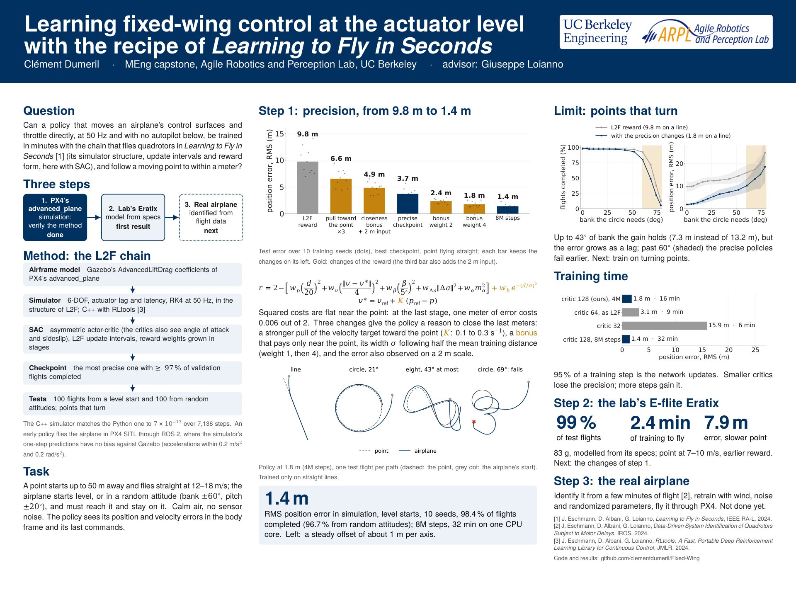

# Poster



[poster.pdf](poster.pdf), 48 × 36 in. Every number comes from the committed results in [`cpp/results`](../cpp/results)
(see [docs/RESULTS.md](../docs/RESULTS.md)).

Build, from the repository root:

```bash
python poster/make_figures.py --flights <runs>/reference_suite_fine/fine2m_bonus4_seed4/flights
cd poster && tectonic poster.tex
```

`--flights` is the folder written by `build/evaluate_reference_fine <run>/best_actor.h <out> --record 3` for seed 4 of
`fine2m_bonus4` (the flights are not committed); without it, `figures/flights.pdf` is kept as it is.
